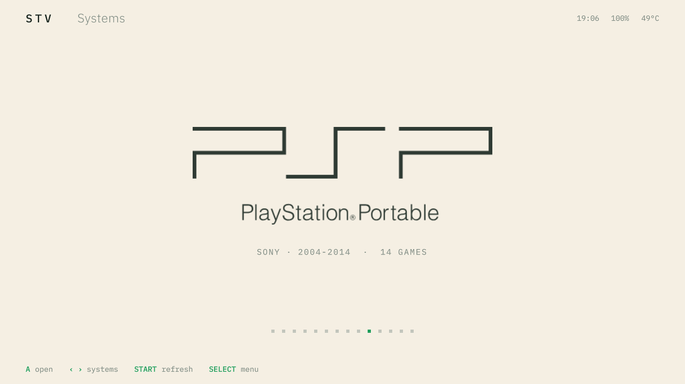

<b>English</b> · <a href="README.es.md">Español</a>

[STV OS](../../README.md) › **TrimUI Smart Pro S**

# STV OS for the TrimUI Smart Pro S

**[Overview](overview.md)** · **[Releases](releases.md)** · **[Manual](manual.md)**

## Quick start

1. **Choose** where to install it: [internal memory or microSD card](releases.md#which-installation-to-choose).
2. **Download** the file for that installation from [Available versions](releases.md#available-versions).
3. **Install** it following the steps: [internal memory](releases.md#install-on-the-internal-memory) or
   [microSD card](releases.md#install-on-a-microsd-card).
4. **Set up** the language, time zone and Wi-Fi in STV Settings, and copy your games to
   `Roms/<system>/` ([manual](manual.md#games-and-the-roms-folder)).

| | |
|---|---|
| Latest version | **0.0.1-beta** (2026-10-10) · [download and install](releases.md) |
| System | Android 13, custom kernel (Linux 5.15) |
| Console | TrimUI Smart Pro S (Allwinner A523, 1 GB RAM, Mali-G57 GPU, 1280×720 screen) |
| Installs on | the **internal memory** (replaces the factory firmware) or a **microSD card** (the factory firmware stays untouched) |
| Main goal | PSP at full speed, at higher than native resolution, in the heaviest games |

## Sections

- **[Overview](overview.md)**: what STV OS is, what it changes in the console and the measured
  results in PSP.
- **[Releases](releases.md)**: how to install on the internal memory or on a microSD card, the
  downloads of each version and the kernel source code that each one uses.
- **[Manual](manual.md)**: the home screen, the buttons and shortcuts, the control center, open
  apps, the STV apps, emulators, saves and updates.
