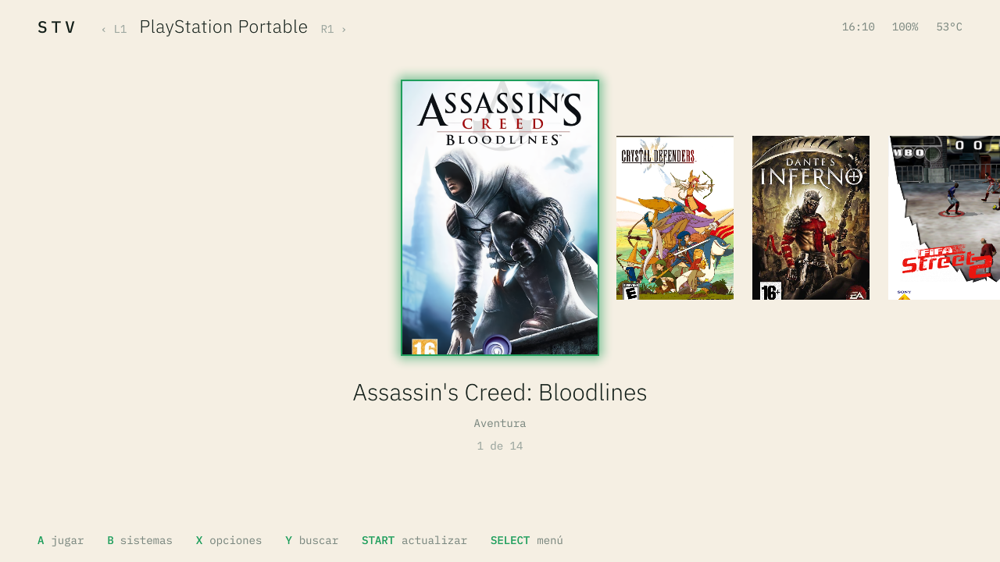
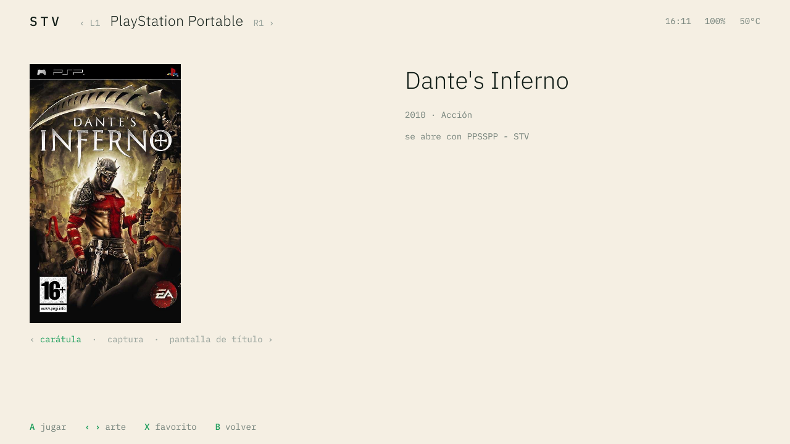
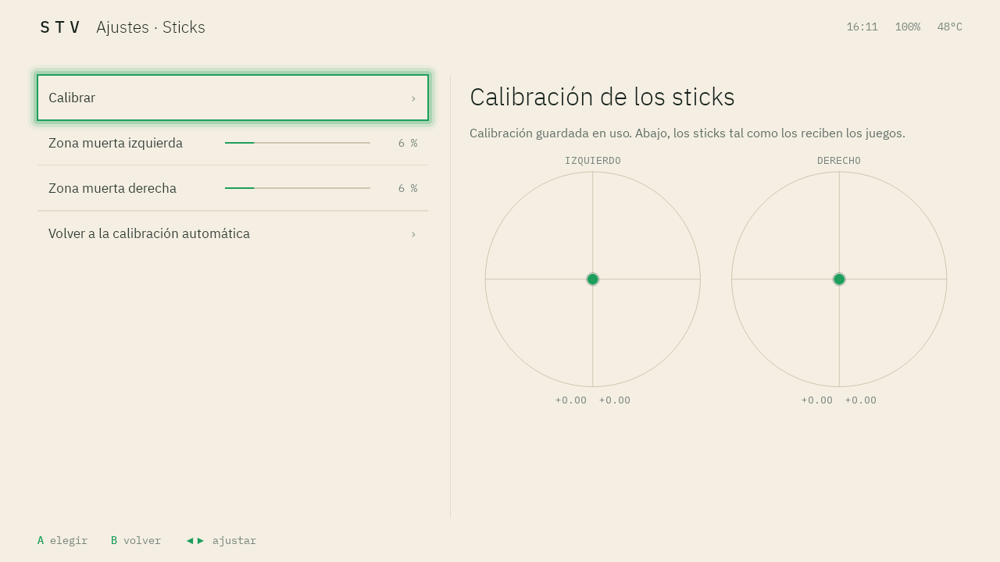
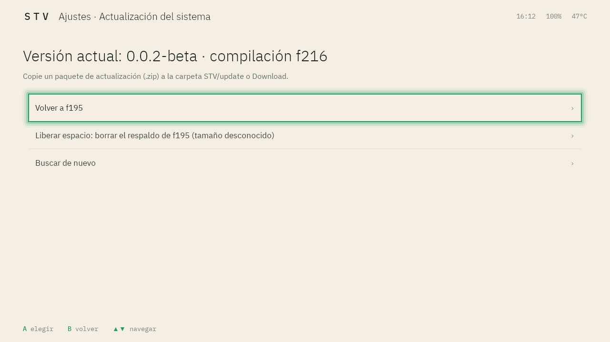

<a href="manual.md">English</a> · <b>Español</b>

[STV OS](../../README.es.md) › [TrimUI Smart Pro S](README.es.md) · [Presentación](overview.es.md) · [Descargas e instalación](releases.es.md) · **Manual**

# Manual

- [Botones y atajos](#botones-y-atajos)
- [La pantalla de inicio](#la-pantalla-de-inicio)
- [Centro de control (HOME)](#centro-de-control-home)
- [Apps abiertas (MENU)](#apps-abiertas-menu)
- [Avisos](#avisos)
- [Pantalla de bloqueo](#pantalla-de-bloqueo)
- [Ajustes STV](#ajustes-stv)
- [Administrar Sistemas](#administrar-sistemas)
- [Emuladores](#emuladores)
- [PPSSPP - STV](#ppsspp---stv)
- [Los juegos y la carpeta Roms](#los-juegos-y-la-carpeta-roms)
- [Partidas](#partidas)
- [Actualizaciones](#actualizaciones)
- [Solución de problemas](#solución-de-problemas)
- [Reportar un problema](#reportar-un-problema)

## Botones y atajos

Funcionan en todas partes, también dentro de un juego:

| Botón | Qué hace |
|---|---|
| **HOME** (botón superior) | Abre y cierra el [centro de control](#centro-de-control-home) |
| **MENU** | Abre y cierra la vista de [apps abiertas](#apps-abiertas-menu), para pasar de una app a otra o cerrarlas |
| **Volumen + / −** | Cambia el volumen; mantenerlo pulsado lo sigue cambiando |
| **POWER**, pulsación corta | Apaga la pantalla y suspende la consola; otra pulsación la despierta |
| **POWER**, 20 segundos | Fuerza el apagado, si la consola no responde |
| **L1 + R1** a la vez | Desbloquean la [pantalla de bloqueo](#pantalla-de-bloqueo) |
| **Switch FN** | Hace lo elegido en [Ajustes STV › Switch FN](#ajustes-stv): modo puntero (predeterminado), rendimiento alto para PSP, silencio, bloquear HOME y MENU en el juego, o nada |

Dentro de cada emulador:

| Emulador | Su menú | Otros |
|---|---|---|
| PSP (PPSSPP - STV) | **L2** (menú de pausa) | **R2**: avance rápido. Los botones siguen la posición de los de la PSP: Equis abajo, Círculo a la derecha, Cuadrado a la izquierda, Triángulo arriba |
| Nintendo 64 (Mupen64Plus FZ) | **START + SELECT** | Para salir de un juego, use *Salir* en ese menú. En la instalación en memoria interna, en ese momento se copian las partidas a la tarjeta |
| Todo lo demás (RetroArch) | **START + SELECT** | Bisel y filtro de pantalla por sistema, ya configurados |

## La pantalla de inicio

La pantalla de inicio es **Pegasus**, un lanzador de juegos con el tema STV. Abre en el **menú de sistemas**:
un sistema por pantalla, con su logo, fabricante, años y cantidad de juegos. Además de los sistemas de juegos
hay tres colecciones, *Últimos jugados*, *Favoritos* (cada una aparece cuando tiene algo) y *Todos los
juegos*; la colección **Android**, con las apps instaladas; y, al final, *Administrar Sistemas* y
*Ajustes STV*.

| Botón | En el menú de sistemas | En una lista de juegos |
|---|---|---|
| **Izquierda / derecha** | Sistema anterior / siguiente | Recorre los juegos |
| **L1 / R1** | Sistema anterior / siguiente | Sistema anterior / siguiente |
| **A** | Entra al sistema | Abre el juego con su emulador predeterminado |
| **B** | | Vuelve al menú de sistemas |
| **X** | | Opciones del juego (más abajo) |
| **Y** | | Buscar por nombre |
| **START** | Actualiza la biblioteca (después de agregar o borrar juegos) | Igual |
| **SELECT** | Menú de Pegasus (sus ajustes, entre ellos el tema) | Igual |

Los sistemas de juegos abren en la vista **galería**: las carátulas en fila, con la elegida ampliada. Al volver
de un juego, la lista queda en ese mismo juego.

**Opciones del juego (X):** marcar el juego como favorito, abrir su ficha completa, elegir el emulador (para
PSP, *PPSSPP - STV*, el predeterminado, o el *PPSSPP* oficial), elegir la vista del sistema (grilla, lista,
lateral o galería; se recuerda para cada sistema) o eliminar el juego y su arte de la consola.

La **ficha completa** muestra el arte en grande y los datos del juego; izquierda y derecha cambian entre
carátula, captura y pantalla de título.

La colección **Android** muestra las apps instaladas: *Administrar Sistemas*, *Ajustes STV*, los emuladores,
Aurora Store y cualquier app que se instale.

**Temas:** *STV Claro* y *STV Oscuro* siguen el tema claro u oscuro elegido en Ajustes STV. *STV Neo* es una
versión del tema Retro Mega Neo de hazem-abdelghani, adaptada a esta consola (CC BY-NC-SA 4.0). Se cambia en
**SELECT › Ajustes › Tema**.

## Centro de control (HOME)

El centro de control es el panel de ajustes rápidos de la consola. **HOME** lo abre sobre lo que haya en
pantalla, para cambiar el brillo, el Wi-Fi, el ventilador o el perfil de rendimiento sin salir del juego.
También saca capturas de pantalla y abre los avisos.

| Fila | Qué hace |
|---|---|
| **Wi-Fi**, **Bluetooth** | Encienden o apagan la radio |
| **Puntero** | Modo mouse: el stick derecho mueve un cursor y el izquierdo hace scroll (para apps pensadas para pantalla táctil) |
| **LEDs de los sticks** | Encienden o apagan los aros de los sticks |
| **Cooler** | Ventilador: *auto* (predeterminado), *leve*, *medio*, *máximo* o *apagado* |
| **CPU** | Perfil de rendimiento: *ahorro*, *normal*, *alto*, *alto · psp* (predeterminado) o *máximo* |
| **GPU** | Perfil gráfico, con las mismas opciones |
| **Brillo** | Izquierda y derecha lo ajustan |

El perfil de CPU predeterminado, *alto · psp*, está optimizado para PSP. El perfil *máximo* sube todavía más
los límites, con más calor y más consumo de batería. Debajo de los perfiles, el panel muestra los relojes
actuales de la CPU y la GPU.

**A** cambia la fila elegida, **B** cierra el panel, **X** saca una captura de pantalla (se guarda en
`Pictures/Screenshots`) y **START** abre los [avisos](#avisos).

**Y** sobre la fila de CPU o de GPU abre el **monitor de rendimiento**: el reloj de cada núcleo en los
últimos 15 minutos, junto al techo del perfil vigente. Izquierda y derecha amplían un núcleo.

## Apps abiertas (MENU)

La vista de apps abiertas es el selector de apps de la consola. **MENU** muestra las apps abiertas y qué hace
cada una (en juego, en uso, en segundo plano), para volver a un juego sin abrirlo de nuevo o cerrar lo que no
se usa y liberar memoria. Arriba se ve la memoria libre.

**A** abre la app elegida, **X** la cierra, **Y** va a la pantalla de inicio, **B** vuelve y **SELECT**
reinicia Pegasus.

## Avisos

La consola no tiene barra de estado: los avisos son donde informa la batería baja, la temperatura alta, un
cable USB conectado o una captura guardada, y adonde llegan las notificaciones de las apps. **START** en el centro de control los abre: **A** abre uno, **X** lo descarta e
**Y** los limpia todos. Con *Vibración en avisos* encendida, la consola vibra una vez por cada aviso nuevo.

## Pantalla de bloqueo

La pantalla de bloqueo evita pulsaciones accidentales cuando la consola despierta. Muestra el reloj, la fecha
y la batería; pulse **L1 + R1** a la vez para desbloquearla.

Elija el bloqueo en **Ajustes STV › Seguridad**: *Ninguno*, *L1 + R1* (predeterminado) o un *PIN* de 4 a 16
dígitos. El PIN se escribe con el mando: la cruz direccional mueve la selección, **A** escribe, **B** borra y
**START** confirma.

## Ajustes STV

Ajustes STV es la app de ajustes de la consola. Reemplaza los ajustes de Android, hechos para pantallas
táctiles, por una lista con lo que importa en esta consola: pantalla, sonido, LEDs, bloqueo, almacenamiento,
actualizaciones. Los ajustes completos de Android siguen disponibles en *Sistema*. **A** elige, **B** vuelve,
izquierda y derecha ajustan.

| Sección | Qué hay |
|---|---|
| **Transferencia USB** | La computadora ve la consola como una unidad, para copiar juegos. Mientras está activa, la consola no se puede usar |
| **Pantalla** | Brillo, tiempo de espera, temperatura de color, tamaño del texto y tema (claro u oscuro; cambia a la vez Android, las apps STV y Pegasus) |
| **Sonido y vibración** | Vibración al pulsar y en los avisos, ganancia de auriculares y el micrófono para los juegos |
| **Wi-Fi** | La pantalla de Wi-Fi de Android |
| **LEDs de los sticks** | Color y brillo de cada aro, con un color RGB a medida |
| **Puntero (modo mouse)** | Encendido o apagado, y la velocidad del cursor |
| **Calibración de los sticks** | Mide el centro y el recorrido de los dos sticks y aplica el resultado en todas las apps y emuladores; zona muerta de cada stick y vuelta a la calibración automática |
| **Switch FN** | Qué hace el switch FN al pasarlo a ON |
| **Seguridad** | La [pantalla de bloqueo](#pantalla-de-bloqueo) |
| **Desarrollo** | Depuración por USB (adb) y acceso root. Apagados en una instalación limpia |
| **Almacenamiento** | Espacio usado en la memoria interna y en la tarjeta microSD; en la instalación en microSD, también *Ampliar a toda la tarjeta* |
| **Sistema** | Reiniciar, apagar y los ajustes completos de Android (vincular Bluetooth, teclado, permisos de las apps) |
| **Idioma del sistema** | La lista de idiomas de Android. STV OS está en inglés y en español; las apps STV y Pegasus lo siguen |
| **Fecha y hora** | Zona horaria: *Tiempo universal coordinado (UTC)* o una región y una ciudad. La hora se ajusta sola con Wi-Fi |
| **Actualización del sistema** | Instalar una versión nueva o volver a la anterior ([actualizaciones](#actualizaciones)) |
| **Apoyar el proyecto** | Un código QR que lleva a la página de apoyo |
| **Acerca de la consola** | Versión, kernel, memoria, almacenamiento, tipo de instalación y licencias de terceros |

<table>
<tr><td></td><td></td></tr>
<tr><td></td><td></td></tr>
<tr><td></td><td></td></tr>
<tr><td></td><td></td></tr>
<tr><td colspan="2"></td></tr>
</table>

## Administrar Sistemas

*Administrar Sistemas* administra la biblioteca de juegos. Un *sistema* es una consola emulada (PSP,
Nintendo 64, Game Boy…): la app agrega sistemas, instala sus cores de emulador, busca carátulas y respalda
partidas. Está en el sistema **Android** de la pantalla de inicio.

- **A sobre un sistema** muestra sus juegos, con un punto en los que ya tienen carátula y datos.
  *Obtener lo que falta* los busca en internet (necesita Wi-Fi y tarda unos segundos por juego);
  *Obtener todo de nuevo* lo repite para todos.
- **Y dentro de un sistema** muestra el core de su emulador: cuál se usa y *Actualizar core* para descargar
  el último.
- **START** abre el catálogo de sistemas. Al elegir uno se crea su carpeta `Roms/<sistema>`, se prepara su
  emulador y, si hace falta, se descarga el core.
- **Y sobre la lista** abre las [partidas](#partidas): *Respaldar* y *Restaurar*.

<table>
<tr><td></td><td></td></tr>
<tr><td></td><td></td></tr>
</table>

## Emuladores

STV OS instala y configura los emuladores. Cada sistema se abre con el de esta tabla:

| Sistema | Emulador | Notas |
|---|---|---|
| PSP | **PPSSPP - STV** (predeterminado) y el PPSSPP oficial | [Optimizado para esta consola](#ppsspp---stv) |
| Nintendo 64 | Mupen64Plus FZ | GLideN64, el renderizador más rápido en esta consola |
| PlayStation | RetroArch (PCSX-ReARMed) | Funciona sin archivo de BIOS en la mayoría de los juegos |
| Game Boy Advance | RetroArch (mGBA) | |
| Game Boy, Game Boy Color, NES, SNES | RetroArch (Gambatte, FCEUmm, Snes9x 2010) | |
| Neo Geo, arcade, CPS-1, CPS-2, CPS-3 | RetroArch (FinalBurn Neo) | **No viene incluido** (su licencia solo permite el uso no comercial). La primera vez que se abre uno de estos juegos, *Administrar Sistemas* ofrece *Instalar core* (necesita Wi-Fi, unos 70 MB) |
| MAME | RetroArch (MAME 2003-Plus) | **No viene incluido** (su licencia solo permite el uso no comercial). Usa los romsets de MAME 0.78; MAME 2010 y MAME 2000 quedan como alternativas para otros romsets. Se instala igual que FinalBurn Neo (necesita Wi-Fi, unos 40 MB) |
| Otros | RetroArch | Se agregan desde el catálogo de *Administrar Sistemas* |

## PPSSPP - STV

PPSSPP - STV es una versión de PPSSPP 1.20.4 adaptada al hardware de esta consola: el Allwinner A523, su GPU
Mali-G57, 1 GB de RAM y la pantalla de 1280×720. Es el emulador de PSP predeterminado; el PPSSPP oficial
está instalado a su lado. Cada cambio se midió en la consola, escena por escena, y mantiene la imagen
idéntica a la original ([resultados](overview.es.md#rendimiento-en-psp)).

Lo que se ve:

- **Resoluciones para esta pantalla**, en *Gráficos › Resolución de renderizado*: *2.25x PSP (STV)*
  (1080×612) y *Panel 1:1 (STV)*, el tamaño exacto de la pantalla, más pasos intermedios (1.25x, 1.5x,
  1.75x, 2.5x, 2.75x).
- **Frame rate cap (STV)**: fija un juego en 30 fps, para los títulos diseñados para 30, con un ritmo de
  cuadros parejo.
- **Ajustes por juego**: los ajustes cambiados durante la partida se guardan para ese juego, no para todos.
- **Botones en la disposición de la PSP**, iguales para todos los juegos, y el menú de pausa en **L2**.

Cómo se logra:

- **Gráficos en su propio hilo.** La CPU emulada ya no espera a los comandos gráficos: +10 % de velocidad y
  61 % menos cortes de audio en las escenas más pesadas.
- **Renderizado ajustado a la Mali-G57**, una GPU por mosaicos: los borrados de pantalla se dibujan como
  geometría, el área de render se alinea al tamaño del mosaico y hay menos pasadas por memoria por cuadro.
- **Sombras más baratas.** Los volúmenes de sombra de los *God of War* y de *Dante's Inferno* se parten en
  tramos cortos y cada proyección se recorta a la parte de la pantalla que puede cambiar.
- **Sin trabajo inútil.** Se omiten los dibujos que no cambian nada, las copias de texturas se limitan a lo
  escrito y las reinterpretaciones de formato a lo que cambió desde la última; los búferes auxiliares, como
  los mapas de sombras, pueden renderizarse a menor escala por juego.
- **Sin reservas de memoria en el camino crítico.** El asignador de memoria de la consola funciona en modo
  de poca RAM y es lento bajo carga; el hilo gráfico lo evita.
- **PSP Color** (la respuesta de color de la pantalla original) aplicado en la pasada final, en punto
  flotante de 16 bits.

## Los juegos y la carpeta Roms

Los juegos van en una carpeta `Roms`, con una subcarpeta por sistema en minúsculas: `Roms/psp`, `Roms/n64`,
`Roms/gba`, `Roms/ps1`, `Roms/neogeo`, `Roms/nes`, `Roms/snes`…

- **Instalación en memoria interna:** `Roms` está en la raíz de la tarjeta microSD (FAT32). Los juegos se
  copian con un lector de tarjetas o por USB (*Transferencia USB* muestra la tarjeta como una segunda unidad).
  La tarjeta se puede insertar y retirar con la consola encendida; la biblioteca se actualiza sola.

  La tarjeta puede tener formato **FAT32** o **exFAT** (el habitual de las tarjetas de 64 GB o más): los dos se
  probaron con juegos, partidas y actualizaciones.
- **Instalación en microSD:** `Roms` está en el almacenamiento interno de la consola, la unidad que ve la
  computadora con **Ajustes STV › Transferencia USB**. Los juegos se copian por ahí.

Los juegos van directamente dentro de la carpeta del sistema, no en subcarpetas, y su nombre de archivo no
puede tener más de tres puntos, contando la extensión. *Administrar Sistemas* crea las carpetas y el archivo
`metadata.pegasus.txt` de cada sistema. Después de copiar juegos, pulse **START** en la pantalla de inicio
para actualizar la biblioteca.

## Partidas

Cada emulador guarda sus partidas en su propia carpeta. *Administrar Sistemas* las respalda todas en un solo
archivo.

| Emulador | Instalación en memoria interna | Instalación en microSD |
|---|---|---|
| PSP | En la tarjeta: `Android/data/org.ppsspp.ppsspp.stv/files/PSP/` | Almacenamiento interno, misma ruta |
| RetroArch | En la tarjeta: `Android/data/com.retroarch.aarch64/files/` | Almacenamiento interno: `RetroArch/saves` y `RetroArch/states` |
| Nintendo 64 | En la tarjeta: `STV/saves/n64/` | Almacenamiento interno: `M64Plus/GameData/` |

**Respaldar:** *Administrar Sistemas* › **Y** › *Respaldar* junta las partidas de estos tres emuladores en un
solo archivo, `STV/backups/saves-<fecha>.zip` (en la tarjeta en la instalación en memoria interna). Copie ese
archivo en una computadora: reinstalar borra el almacenamiento interno. **Restaurar** muestra los respaldos y
puede guardar antes una copia de las partidas actuales.

En la instalación en memoria interna, las partidas viven en la tarjeta: sin ella, los emuladores no pueden
guardar, y la consola lo avisa. No retire la tarjeta con un juego abierto.

## Actualizaciones

STV OS se actualiza desde la consola, sin reinstalar. Cada versión publica un paquete de actualización por
tipo de instalación, firmado, que se instala sobre cualquier versión anterior y conserva juegos, partidas,
apps y ajustes. La versión anterior queda disponible para volver.

1. Descargue el paquete de su instalación desde [Versiones disponibles](releases.es.md#versiones-disponibles):
   el que termina en `-internal-memory.zip` (memoria interna) o el que termina en `-microsd.zip`. No lo
   renombre ni lo descomprima.
2. Cópielo en la carpeta `STV/update` del almacenamiento interno. También sirve la carpeta `Download` y, en la
   instalación en memoria interna, `STV/update` en la tarjeta.
3. Abra **Ajustes STV › Actualización del sistema**. Encuentra el paquete, muestra sus notas y pide confirmar.
4. La consola prepara la actualización en unos minutos mientras se puede seguir usando; después reinicia y la
   instala. El logo queda en pantalla unos 3 minutos. No la apague.
5. La consola reinicia con la versión nueva. **Volver a <compilación>** regresa a la anterior.

La actualización necesita un 40 % de batería o el cargador conectado. Un paquete hecho para el otro tipo de
instalación se rechaza antes de escribir nada, y solo se aceptan paquetes firmados.

## Solución de problemas

**¿La consola no arranca?**

- **Instalación en microSD:** retire la tarjeta. Si la consola arranca su firmware de fábrica, el problema
  está en la tarjeta: grábela de nuevo con Raspberry Pi Imager (se borra lo que tenga).
- **Instalación en memoria interna:** instale STV OS de nuevo siguiendo
  [Instalar en la memoria interna](releases.es.md#instalar-en-la-memoria-interna). Se borran los datos
  internos; los juegos y las partidas de la tarjeta se conservan.

**¿La pantalla queda negra después de reiniciar?** Pulse POWER una vez para apagar la pantalla y otra vez
para encenderla.

**¿Los dos aros de los sticks se pusieron rojos?** El almacenamiento interno quedó en solo lectura por un
error del sistema de archivos (por ejemplo, después de un corte de energía). No se está guardando nada. Apague
la consola desde **Ajustes STV › Sistema › Apagar** y vuelva a encenderla. Al arrancar, revisa y repara el
almacenamiento.

**¿Un stick se mueve solo o no llega al máximo?** Abra **Ajustes STV › Calibración de los sticks** y
elija *Calibrar*: suelte los dos sticks y, cuando se lo pida, gírelos despacio por todo el borde. Si el
movimiento sigue apareciendo sin tocar el stick, aumente su *zona muerta*.

**¿Olvidó el PIN?** No se puede recuperar. Instalar STV OS de nuevo lo quita, junto con los datos internos de
la consola; en la instalación en memoria interna, los juegos y las partidas de la tarjeta se conservan.

**¿La consola no ve la tarjeta microSD o sus juegos (instalación en memoria interna)?** Revise que la tarjeta
tenga formato FAT32 o exFAT; otros formatos, como NTFS, no se leen. Formatearla la borra, así que antes copie
todo su contenido (juegos, partidas y respaldos) a una computadora.

**¿Un juego no aparece?** Revise que esté directamente en `Roms/<sistema>/`, que la carpeta del sistema tenga
su `metadata.pegasus.txt` (lo crea *Administrar Sistemas*) con la extensión del juego y que el nombre no
tenga más de tres puntos. Después pulse **START** en la pantalla de inicio.

**¿Un juego de Neo Geo, arcade o MAME abre la pantalla del core?** FinalBurn Neo y MAME 2003-Plus no vienen incluidos. Pulse **A**
en *Instalar core* (con Wi-Fi) y después **B** para volver; el juego se abre.

## Reportar un problema

Incluya:

- la versión y la compilación que muestra **Ajustes STV › Acerca de la consola** (por ejemplo,
  *0.0.2-beta · compilación f217*);
- el tipo de instalación (memoria interna o microSD);
- qué hizo, qué esperaba y qué pasó, con una captura de pantalla si es posible (**HOME** y después **X**).

Repórtelo en los [Issues](https://github.com/stv-os-android/stv-android-releases/issues) de este repositorio.
