
<a href="manual.md">English</a> · <b>Español</b>

[STV OS](../../README.es.md) › [TrimUI Smart Pro S](README.es.md) · [Presentación](overview.es.md) · [Descargas e instalación](releases.es.md) · **Manual**

# Manual

- [Botones y atajos](#botones-y-atajos)
- [La pantalla de inicio](#la-pantalla-de-inicio)
- [Centro de control (HOME)](#centro-de-control-home)
- [Apps abiertas (MENU)](#apps-abiertas-menu)
- [Avisos](#avisos)
- [Pantalla de bloqueo](#pantalla-de-bloqueo)
- [Ajustes STV](#ajustes-stv)
- [Administrar Sistemas](#administrar-sistemas)
- [Emuladores](#emuladores)
- [Los juegos y la carpeta Roms](#los-juegos-y-la-carpeta-roms)
- [Partidas](#partidas)
- [Actualizaciones](#actualizaciones)
- [Solución de problemas](#solución-de-problemas)
- [Reportar un problema](#reportar-un-problema)

## Botones y atajos

Funcionan en todas partes, también dentro de un juego:

| Botón | Qué hace |
|---|---|
| **HOME** (botón superior) | Abre y cierra el [centro de control](#centro-de-control-home) |
| **MENU** | Abre y cierra la vista de [apps abiertas](#apps-abiertas-menu), para pasar de una app a otra o cerrarlas |
| **Volumen + / −** | Cambia el volumen; mantenerlo pulsado lo sigue cambiando |
| **POWER**, pulsación corta | Apaga la pantalla y suspende la consola; otra pulsación la despierta |
| **POWER**, 20 segundos | Fuerza el apagado, si la consola no responde |
| **L1 + R1** a la vez | Desbloquean la [pantalla de bloqueo](#pantalla-de-bloqueo) |
| **Switch FN** | Hace lo elegido en [Ajustes STV › Switch FN](#ajustes-stv): modo puntero (predeterminado), rendimiento alto para PSP, silencio, bloquear HOME y MENU en el juego, o nada |

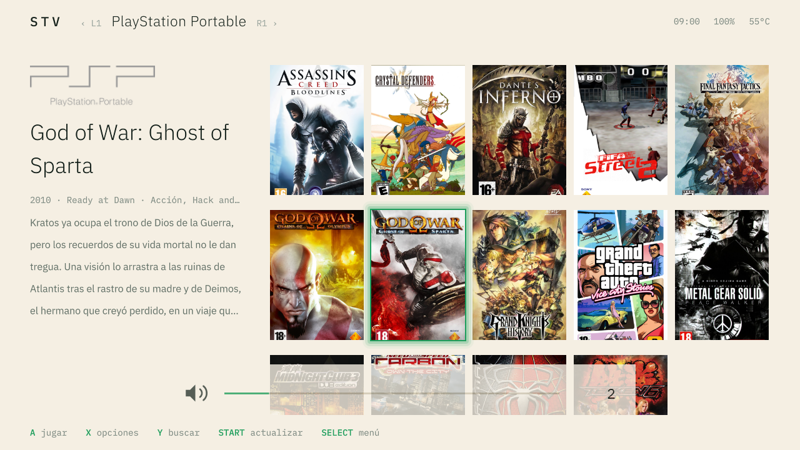

Dentro de cada emulador:

| Emulador | Su menú | Otros |
|---|---|---|
| PSP (PPSSPP - STV) | **L2** (menú de pausa) | **R2**: avance rápido. Los botones siguen la posición de los de la PSP: Equis abajo, Círculo a la derecha, Cuadrado a la izquierda, Triángulo arriba |
| Nintendo 64 (Mupen64Plus FZ) | **START + SELECT** | Para salir de un juego, use *Salir* en ese menú. En la instalación en memoria interna, en ese momento se copian las partidas a la tarjeta |
| Todo lo demás (RetroArch) | **START + SELECT** | Bisel y filtro de pantalla por sistema, ya configurados |

## La pantalla de inicio

La consola arranca en **Pegasus** con el tema STV: una pantalla por sistema, con la carátula de cada juego.

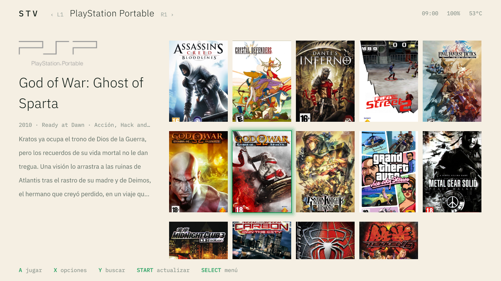

| Botón | Qué hace |
|---|---|
| **L1 / R1** | Sistema anterior / siguiente |
| **Cruz direccional** | Recorre los juegos |
| **A** | Abre el juego con su emulador predeterminado |
| **X** | Opciones del juego (más abajo) |
| **Y** | Buscar por nombre |
| **START** | Actualiza la biblioteca (después de agregar o borrar juegos) |
| **SELECT** | Menú de Pegasus (sus ajustes, ayuda, cerrar) |

**Opciones del juego (X):** elegir el emulador (para PSP, *PPSSPP - STV*, el predeterminado, o el *PPSSPP*
oficial), cambiar la vista del sistema entre grilla y lista, o eliminar el juego y su arte de la consola.

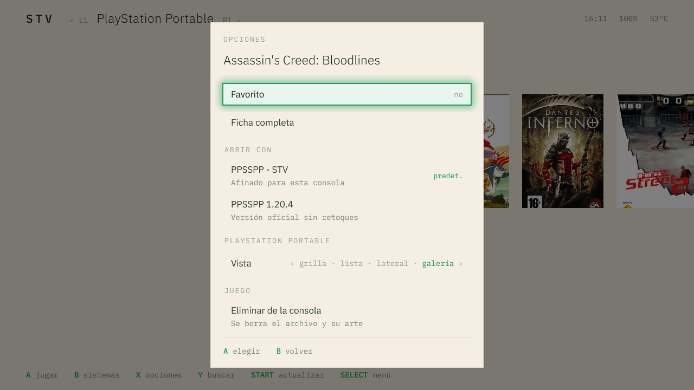

El sistema **Android** muestra las apps instaladas: *Administrar Sistemas*, *Ajustes STV*, los emuladores,
Aurora Store y cualquier app que se instale.

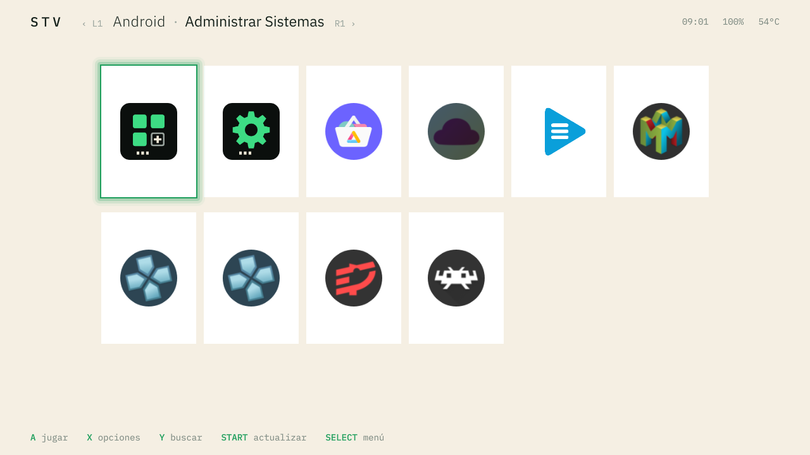

## Centro de control (HOME)

**HOME** abre un panel a la derecha, sobre lo que haya en pantalla.

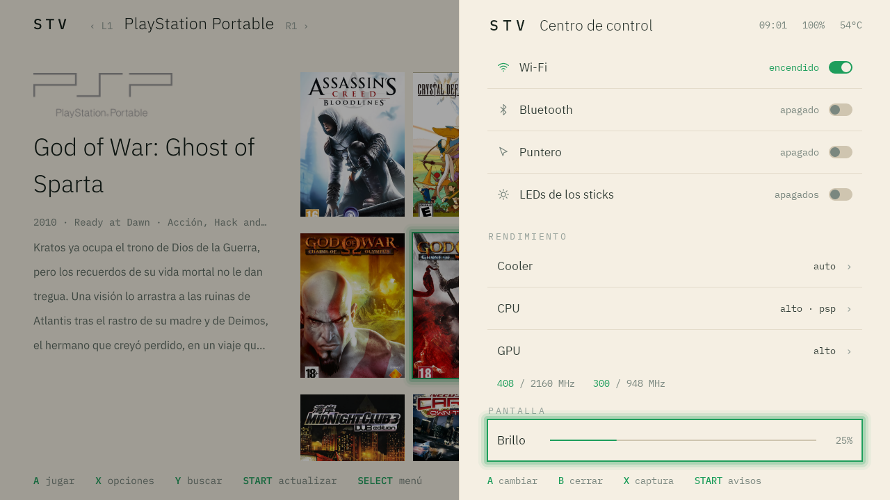

| Fila | Qué hace |
|---|---|
| **Wi-Fi**, **Bluetooth** | Encienden o apagan la radio |
| **Puntero** | Modo mouse: el stick derecho mueve un cursor y el izquierdo hace scroll (para apps pensadas para pantalla táctil) |
| **LEDs de los sticks** | Encienden o apagan los aros de los sticks |
| **Cooler** | Ventilador: *auto* (predeterminado), *leve*, *medio*, *máximo* o *apagado* |
| **CPU** | Perfil de rendimiento: *ahorro*, *normal*, *alto*, *alto · psp* (predeterminado) o *máximo* |
| **GPU** | Perfil gráfico, con las mismas opciones |
| **Brillo** | Izquierda y derecha lo ajustan |

El perfil de CPU predeterminado, *alto · psp*, está optimizado para PSP. El perfil *máximo* sube todavía más
los límites, con más calor y más consumo de batería. Debajo de los perfiles, el panel muestra los relojes
actuales de la CPU y la GPU.

**A** cambia la fila elegida, **B** cierra el panel, **X** saca una captura de pantalla (se guarda en
`Pictures/Screenshots`) y **START** abre los [avisos](#avisos).

**Y** sobre la fila de CPU o de GPU abre el **monitor de rendimiento**: el reloj de cada núcleo en los
últimos 15 minutos, junto al techo del perfil vigente. Izquierda y derecha amplían un núcleo.

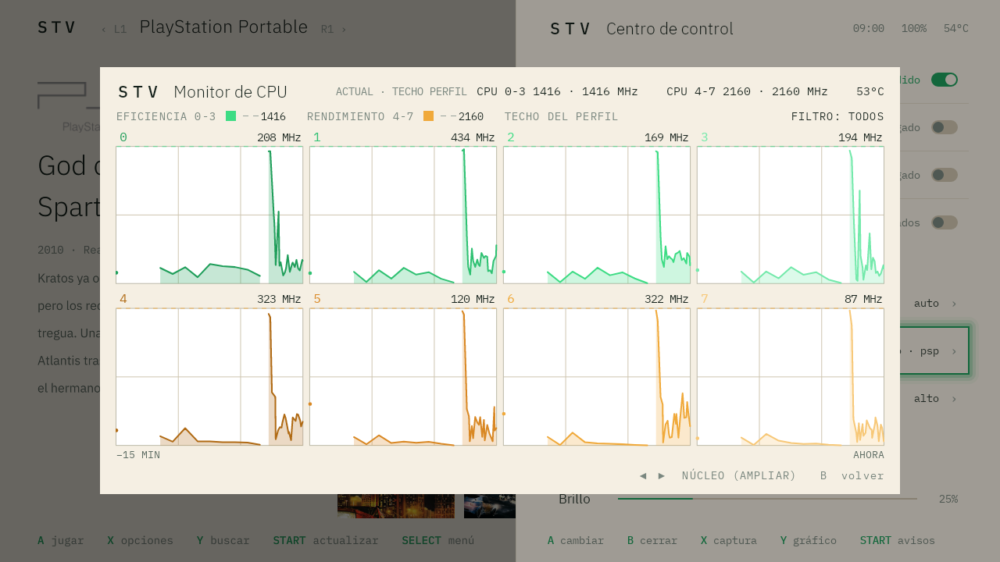

## Apps abiertas (MENU)

**MENU** muestra las apps abiertas y qué hace cada una (en juego, en uso, en segundo plano). Arriba se ve la
memoria libre.

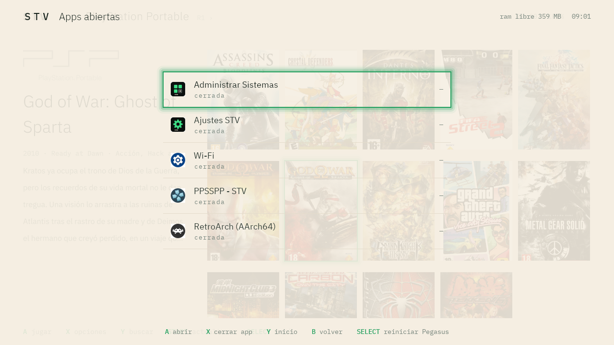

**A** abre la app elegida, **X** la cierra, **Y** va a la pantalla de inicio, **B** vuelve y **SELECT**
reinicia Pegasus.

## Avisos

Los avisos muestran la batería baja, la temperatura alta, un cable USB conectado, una captura guardada y las
notificaciones de las apps. **START** en el centro de control los abre: **A** abre uno, **X** lo descarta e
**Y** los limpia todos. Con *Vibración en avisos* encendida, la consola vibra una vez por cada aviso nuevo.

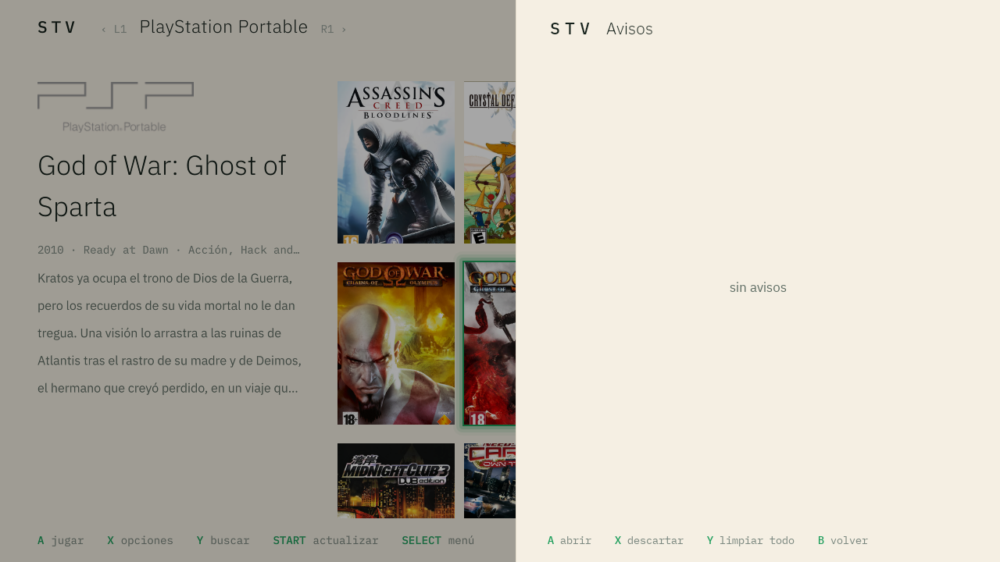

## Pantalla de bloqueo

Al despertar, la consola muestra el reloj, la fecha y la batería. Pulse **L1 + R1** a la vez para
desbloquearla.

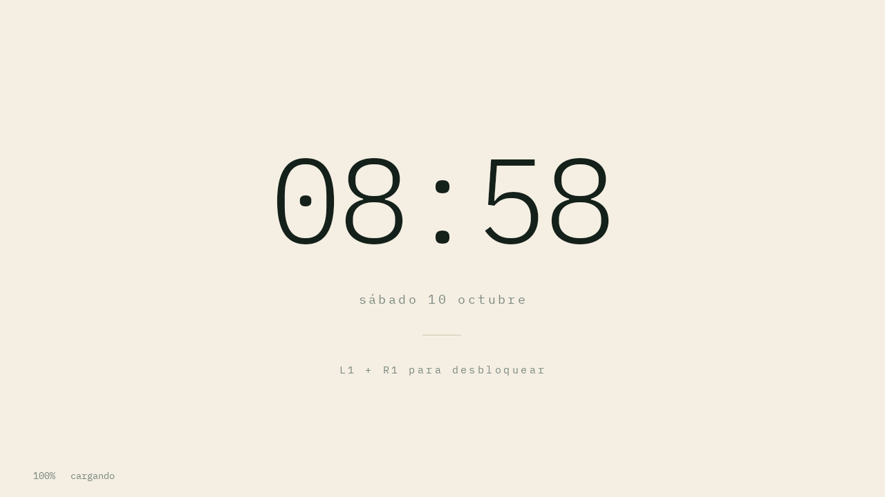

Elija el bloqueo en **Ajustes STV › Seguridad**: *Ninguno*, *L1 + R1* (predeterminado) o un *PIN* de 4 a 16
dígitos. El PIN se escribe con el mando: la cruz direccional mueve la selección, **A** escribe, **B** borra y
**START** confirma.

## Ajustes STV

La app de ajustes de la consola, pensada para el mando: **A** elige, **B** vuelve, izquierda y derecha
ajustan.

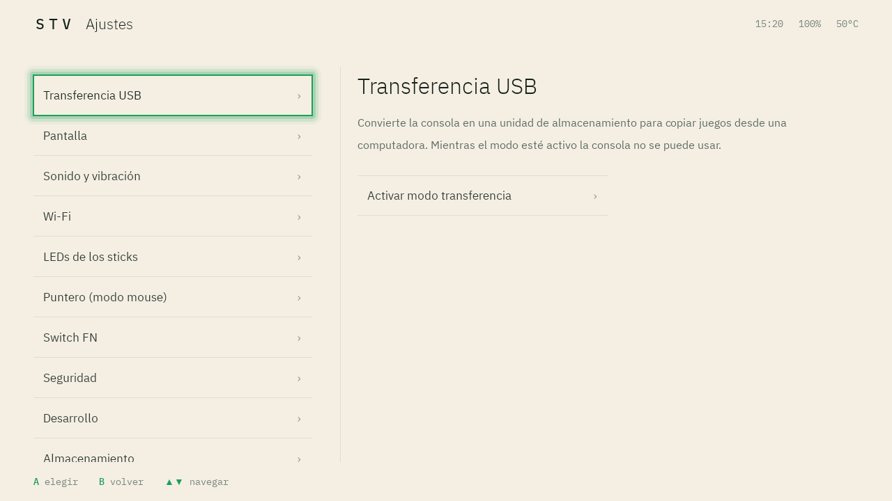

| Sección | Qué hay |
|---|---|
| **Transferencia USB** | La computadora ve la consola como una unidad, para copiar juegos. Mientras está activa, la consola no se puede usar |
| **Pantalla** | Brillo, tiempo de espera, temperatura de color, tamaño del texto y tema (claro u oscuro; cambia a la vez Android, las apps STV y Pegasus) |
| **Sonido y vibración** | Vibración al pulsar y en los avisos, ganancia de auriculares y el micrófono para los juegos |
| **Wi-Fi** | La pantalla de Wi-Fi de Android |
| **LEDs de los sticks** | Color y brillo de cada aro, con un color RGB a medida |
| **Puntero (modo mouse)** | Encendido o apagado, y la velocidad del cursor |
| **Switch FN** | Qué hace el switch FN al pasarlo a ON |
| **Seguridad** | La [pantalla de bloqueo](#pantalla-de-bloqueo) |
| **Desarrollo** | Depuración por USB (adb) y acceso root. Apagados en una instalación limpia |
| **Almacenamiento** | Espacio usado en la memoria interna y en la tarjeta microSD; en la instalación en microSD, también *Ampliar a toda la tarjeta* |
| **Sistema** | Reiniciar, apagar y los ajustes completos de Android (vincular Bluetooth, teclado, permisos de las apps) |
| **Idioma del sistema** | La lista de idiomas de Android. STV OS está en inglés y en español; las apps STV y Pegasus lo siguen |
| **Fecha y hora** | Zona horaria: *Tiempo universal coordinado (UTC)* o una región y una ciudad. La hora se ajusta sola con Wi-Fi |
| **Actualización del sistema** | Instalar una versión nueva o volver a la anterior ([actualizaciones](#actualizaciones)) |
| **Apoyar el proyecto** | Un código QR que lleva a la página de apoyo |
| **Acerca de la consola** | Versión, kernel, memoria, almacenamiento, tipo de instalación y licencias de terceros |

<table>
<tr><td>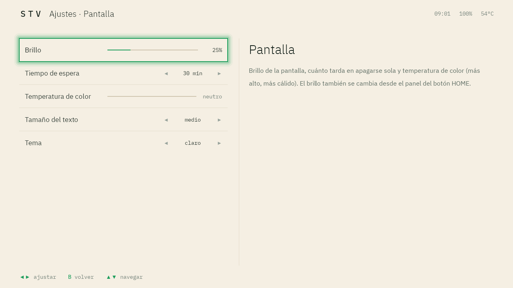</td><td>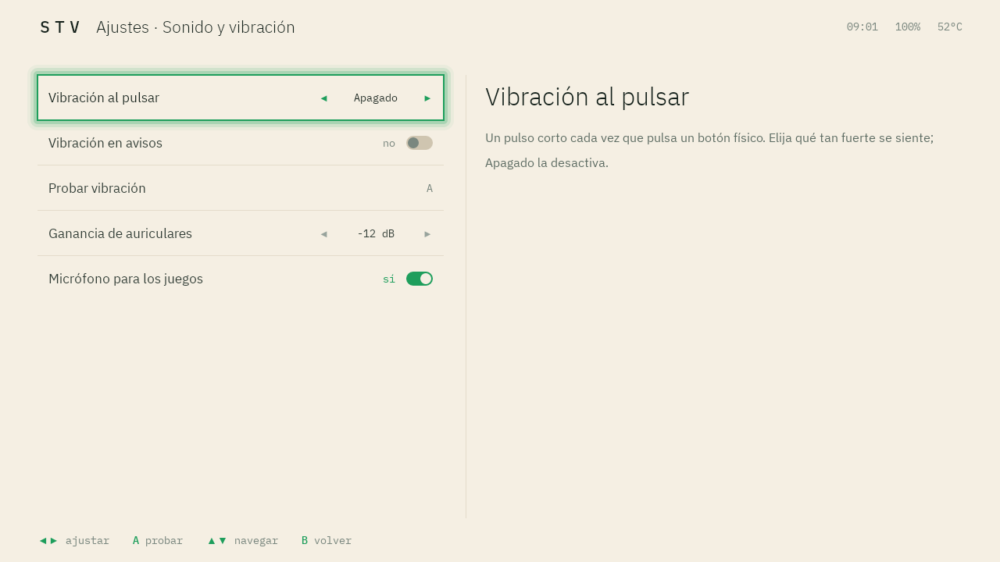</td></tr>
<tr><td>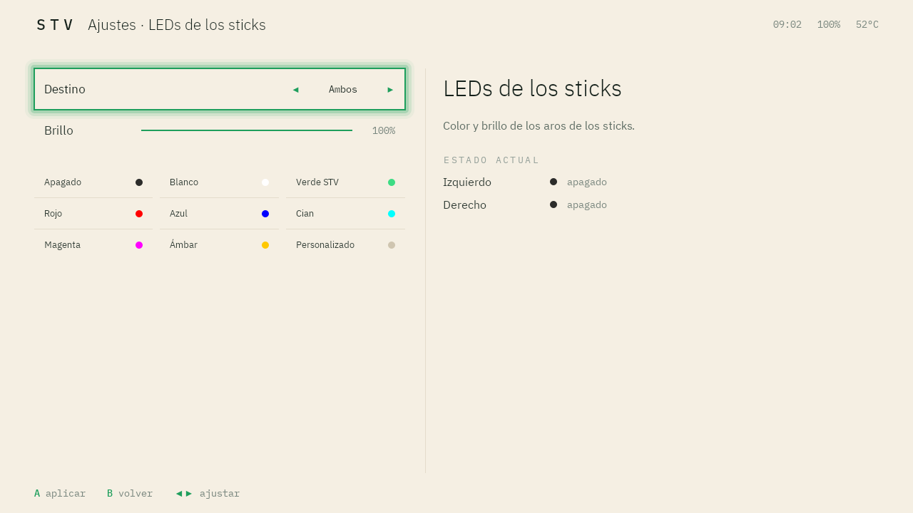</td><td>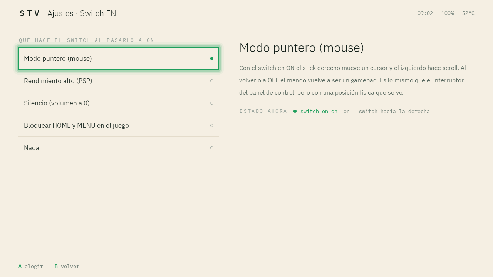</td></tr>
<tr><td>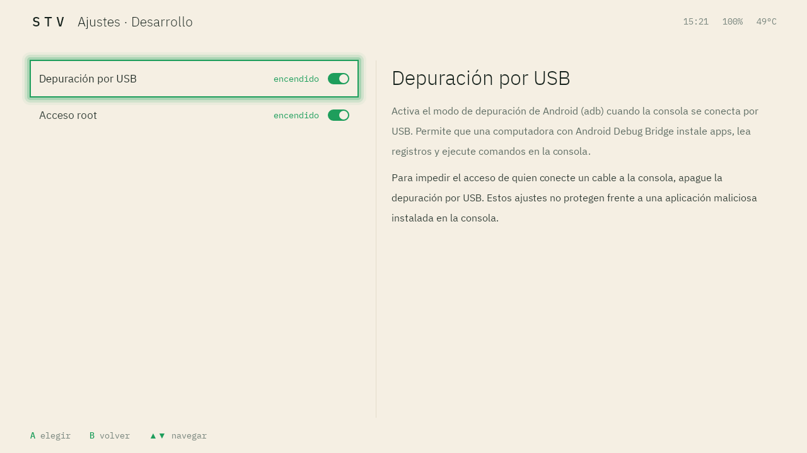</td><td>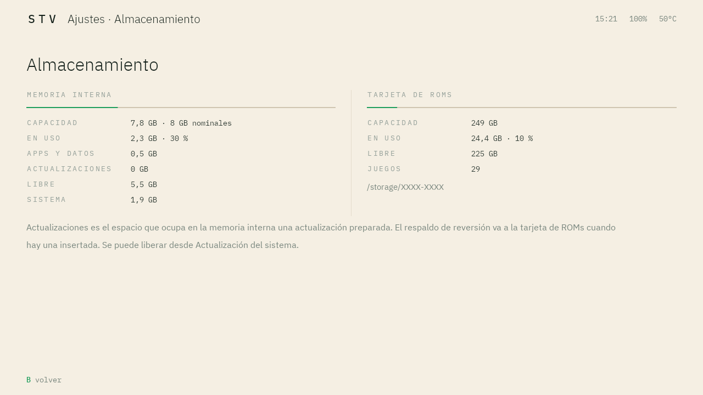</td></tr>
<tr><td>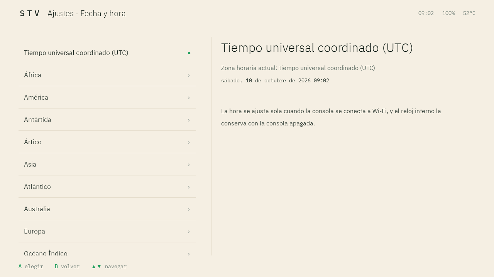</td><td>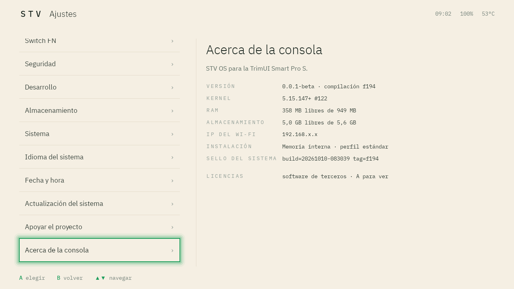</td></tr>
</table>

## Administrar Sistemas

*Administrar Sistemas*, en el sistema **Android** de la pantalla de inicio, agrega sistemas, instala cores de
emuladores, busca carátulas y respalda partidas, todo desde la consola.

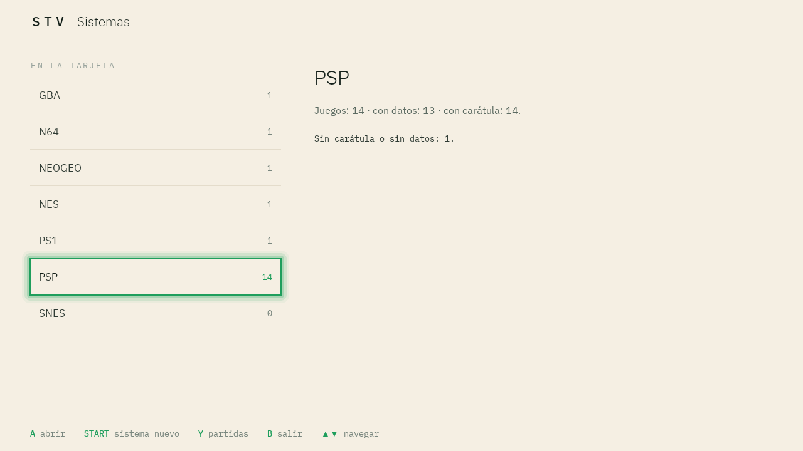

- **A sobre un sistema** muestra sus juegos, con un punto en los que ya tienen carátula y datos.
  *Obtener lo que falta* los busca en internet (necesita Wi-Fi y tarda unos segundos por juego);
  *Obtener todo de nuevo* lo repite para todos.
- **Y dentro de un sistema** muestra el core de su emulador: cuál se usa y *Actualizar core* para descargar
  el último.
- **START** abre el catálogo de sistemas. Al elegir uno se crea su carpeta `Roms/<sistema>`, se prepara su
  emulador y, si hace falta, se descarga el core.
- **Y sobre la lista** abre las [partidas](#partidas): *Respaldar* y *Restaurar*.

<table>
<tr><td>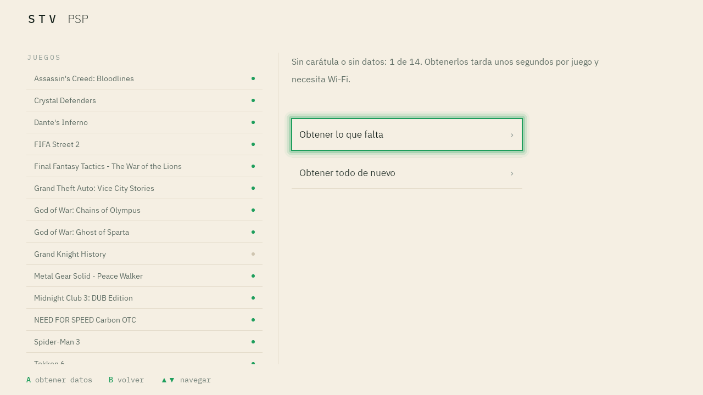</td><td>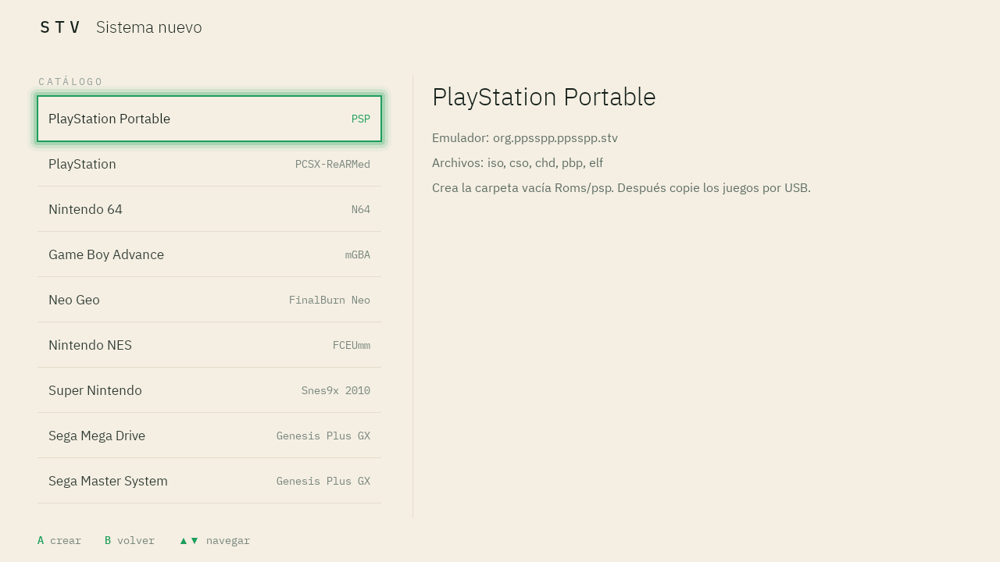</td></tr>
<tr><td>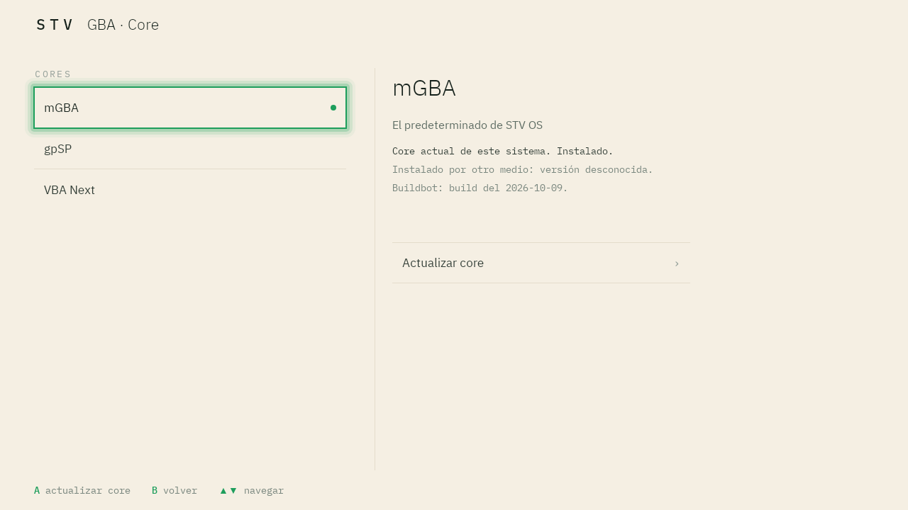</td><td>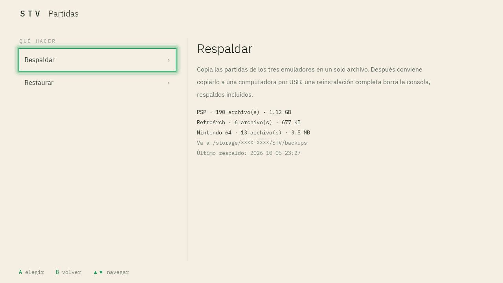</td></tr>
</table>

## Emuladores

| Sistema | Emulador | Notas |
|---|---|---|
| PSP | **PPSSPP - STV** (predeterminado) y el PPSSPP oficial | Optimizado para esta consola. Resoluciones extra *2.25x PSP (STV)* y *Panel 1:1 (STV)* en Gráficos › Resolución de renderizado. Los ajustes se pueden guardar por juego |
| Nintendo 64 | Mupen64Plus FZ | GLideN64, el renderizador más rápido en esta consola |
| PlayStation | RetroArch (PCSX-ReARMed) | Funciona sin archivo de BIOS en la mayoría de los juegos |
| Game Boy Advance | RetroArch (mGBA) | |
| Game Boy, Game Boy Color, NES, SNES | RetroArch (Gambatte, FCEUmm, Snes9x 2010) | |
| Neo Geo, arcade, CPS-1, CPS-2 | RetroArch (FinalBurn Neo) | **No viene incluido** (su licencia solo permite el uso no comercial). La primera vez que se abre uno de estos juegos, *Administrar Sistemas* ofrece *Instalar core* (necesita Wi-Fi, unos 70 MB) |
| Otros | RetroArch | Se agregan desde el catálogo de *Administrar Sistemas* |

## Los juegos y la carpeta Roms

Los juegos van en una carpeta `Roms`, con una subcarpeta por sistema en minúsculas: `Roms/psp`, `Roms/n64`,
`Roms/gba`, `Roms/ps1`, `Roms/neogeo`, `Roms/nes`, `Roms/snes`…

- **Instalación en memoria interna:** `Roms` está en la raíz de la tarjeta microSD (FAT32). Los juegos se
  copian con un lector de tarjetas o por USB (*Transferencia USB* muestra la tarjeta como una segunda unidad).
  La tarjeta se puede insertar y retirar con la consola encendida; la biblioteca se actualiza sola.
- **Instalación en microSD:** `Roms` está en el almacenamiento interno de la consola, la unidad que ve la
  computadora con **Ajustes STV › Transferencia USB**. Los juegos se copian por ahí.

Los juegos van directamente dentro de la carpeta del sistema, no en subcarpetas, y su nombre de archivo no
puede tener más de tres puntos, contando la extensión. *Administrar Sistemas* crea las carpetas y el archivo
`metadata.pegasus.txt` de cada sistema. Después de copiar juegos, pulse **START** en la pantalla de inicio
para actualizar la biblioteca.

## Partidas

| Emulador | Instalación en memoria interna | Instalación en microSD |
|---|---|---|
| PSP | En la tarjeta: `Android/data/org.ppsspp.ppsspp.stv/files/PSP/` | Almacenamiento interno, misma ruta |
| RetroArch | En la tarjeta: `Android/data/com.retroarch.aarch64/files/` | Almacenamiento interno: `RetroArch/saves` y `RetroArch/states` |
| Nintendo 64 | En la tarjeta: `STV/saves/n64/` | Almacenamiento interno: `M64Plus/GameData/` |

**Respaldar:** *Administrar Sistemas* › **Y** › *Respaldar* junta las partidas de estos tres emuladores en un
solo archivo, `STV/backups/saves-<fecha>.zip` (en la tarjeta en la instalación en memoria interna). Copie ese
archivo en una computadora: reinstalar borra el almacenamiento interno. **Restaurar** muestra los respaldos y
puede guardar antes una copia de las partidas actuales.

En la instalación en memoria interna, las partidas viven en la tarjeta: sin ella, los emuladores no pueden
guardar, y la consola lo avisa. No retire la tarjeta con un juego abierto.

## Actualizaciones

1. Copie el paquete de actualización (`STV-TSPS-update-<compilación>.zip`) en la carpeta `STV/update` del
   almacenamiento interno. También sirve la carpeta `Download` y, en la instalación en memoria interna,
   `STV/update` en la tarjeta.
2. Abra **Ajustes STV › Actualización del sistema**. Encuentra el paquete, muestra sus notas y pide confirmar.
3. La consola prepara la actualización en unos 2 minutos mientras se puede seguir usando; después reinicia y
   la instala en 3 a 4 minutos. No la apague.
4. Juegos, partidas, apps y ajustes se conservan. La versión anterior queda guardada: **Volver a
   <compilación>** regresa a ella.

La actualización necesita un 40 % de batería o el cargador conectado. Un paquete hecho para el otro tipo de
instalación se rechaza antes de escribir nada, y solo se aceptan paquetes firmados.

## Solución de problemas

**¿La consola no arranca?**

- **Instalación en microSD:** retire la tarjeta. Si la consola arranca su firmware de fábrica, el problema
  está en la tarjeta: grábela de nuevo con Raspberry Pi Imager (se borra lo que tenga).
- **Instalación en memoria interna:** instale STV OS de nuevo siguiendo
  [Instalar en la memoria interna](releases.es.md#instalar-en-la-memoria-interna). Se borran los datos
  internos; los juegos y las partidas de la tarjeta se conservan.

**¿La pantalla queda negra después de reiniciar?** Pulse POWER una vez para apagar la pantalla y otra vez
para encenderla.

**¿Los dos aros de los sticks se pusieron rojos?** El almacenamiento interno quedó en solo lectura por un
error del sistema de archivos (por ejemplo, después de un corte de energía). No se está guardando nada. Apague
la consola desde **Ajustes STV › Sistema › Apagar** y vuelva a encenderla. Al arrancar, revisa y repara el
almacenamiento.

**¿Olvidó el PIN?** No se puede recuperar. Instalar STV OS de nuevo lo quita, junto con los datos internos de
la consola; en la instalación en memoria interna, los juegos y las partidas de la tarjeta se conservan.

**¿Un juego no aparece?** Revise que esté directamente en `Roms/<sistema>/`, que la carpeta del sistema tenga
su `metadata.pegasus.txt` (lo crea *Administrar Sistemas*) con la extensión del juego y que el nombre no
tenga más de tres puntos. Después pulse **START** en la pantalla de inicio.

**¿Un juego de Neo Geo o de arcade abre la pantalla del core?** FinalBurn Neo no viene incluido. Pulse **A**
en *Instalar core* (con Wi-Fi) y después **B** para volver; el juego se abre.

## Reportar un problema

Incluya:

- la versión y la compilación que muestra **Ajustes STV › Acerca de la consola** (por ejemplo,
  *0.0.1-beta · compilación f195*);
- el tipo de instalación (memoria interna o microSD);
- qué hizo, qué esperaba y qué pasó, con una captura de pantalla si es posible (**HOME** y después **X**).

Repórtelo en los [Issues](https://github.com/littlewild47/stv-android-releases/issues) de este repositorio.
