
<b>English</b> · <a href="manual.es.md">Español</a>

[STV OS](../../README.md) › [TrimUI Smart Pro S](README.md) · [Overview](overview.md) · [Download and install](releases.md) · **Manual**

# Manual

- [Buttons and shortcuts](#buttons-and-shortcuts)
- [The home screen](#the-home-screen)
- [Control center (HOME)](#control-center-home)
- [Open apps (MENU)](#open-apps-menu)
- [Notices](#notices)
- [Lock screen](#lock-screen)
- [STV Settings](#stv-settings)
- [Manage Systems](#manage-systems)
- [Emulators](#emulators)
- [PPSSPP - STV](#ppsspp---stv)
- [Games and the Roms folder](#games-and-the-roms-folder)
- [Saves](#saves)
- [Updates](#updates)
- [Troubleshooting](#troubleshooting)
- [Reporting a problem](#reporting-a-problem)

## Buttons and shortcuts

These work everywhere, even in a game:

| Button | What it does |
|---|---|
| **HOME** (top button) | Opens and closes the [control center](#control-center-home) |
| **MENU** | Opens and closes the [open apps](#open-apps-menu) view, to switch between apps or close them |
| **Volume + / −** | Changes the volume; holding the button keeps changing it |
| **POWER**, short press | Turns the screen off and puts the console to sleep; press again to wake it |
| **POWER**, 20 seconds | Forces the console off, if it does not respond |
| **L1 + R1** together | Unlocks the [lock screen](#lock-screen) |
| **FN switch** | Does what is chosen in [STV Settings › FN switch](#stv-settings): pointer mode (default), high performance for PSP, silence, lock HOME and MENU while playing, or nothing |

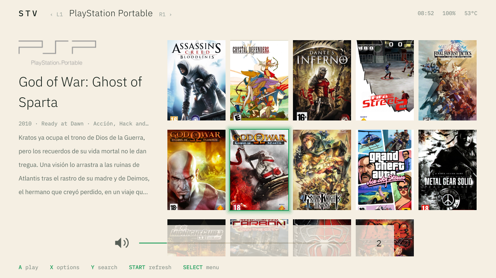

Inside each emulator:

| Emulator | Its menu | Other |
|---|---|---|
| PSP (PPSSPP - STV) | **L2** (pause menu) | **R2**: fast-forward. The buttons follow the PSP layout: Cross bottom, Circle right, Square left, Triangle top |
| Nintendo 64 (Mupen64Plus FZ) | **START + SELECT** | Use *Exit* in that menu to leave a game. In the internal memory installation, that is when the saves are copied to the card |
| Everything else (RetroArch) | **START + SELECT** | Bezel and screen filter per system, already set up |

## The home screen

The home screen is **Pegasus**, a game launcher with the STV theme. It opens on the **systems menu**: one
system per screen, with its logo, maker, years and number of games. Besides the game systems there are
three collections, *Recently played*, *Favorites* (each one appears once it has something in it) and
*All games*; the **Android** collection with the installed apps; and, at the end, *Manage Systems* and
*STV Settings*.

| Button | In the systems menu | In a game list |
|---|---|---|
| **Left / right** | Previous / next system | Move between games |
| **L1 / R1** | Previous / next system | Previous / next system |
| **A** | Opens the system | Opens the game with its default emulator |
| **B** | | Back to the systems menu |
| **X** | | Game options (below) |
| **Y** | | Search by name |
| **START** | Refreshes the library (after adding or removing games) | Same |
| **SELECT** | Pegasus menu (its settings, including the theme) | Same |

Game systems open in the **gallery** view: the box art in a row, with the selected one enlarged. Coming back
from a game puts you on that same game.

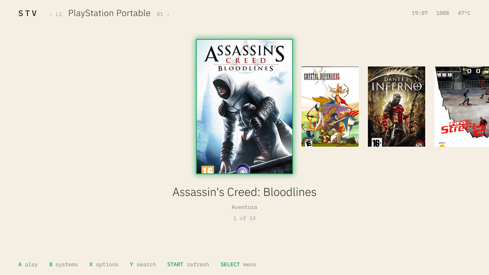

**Game options (X):** mark the game as a favorite, open its full details, choose the emulator (for PSP,
*PPSSPP - STV*, the default, or the official *PPSSPP*), choose the system's view (grid, list, sidebar or
gallery; it is remembered for each system), or delete the game and its artwork from the console.

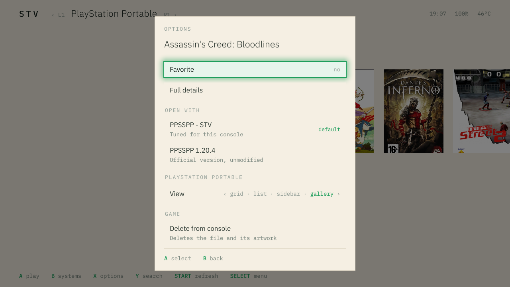

**Full details** shows the large artwork and the game's data; left and right switch between cover,
screenshot and title screen.

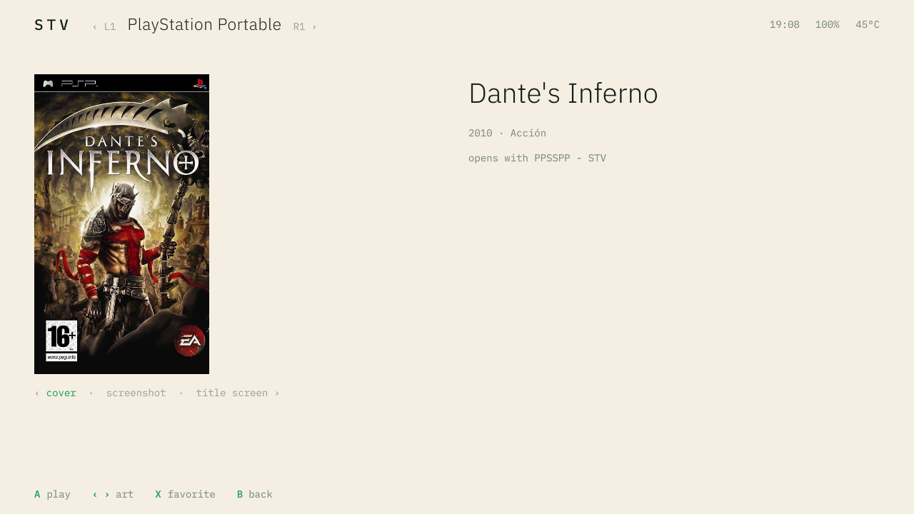

The **Android** collection lists the installed apps: *Manage Systems*, *STV Settings*, the emulators,
Aurora Store and any app you install.

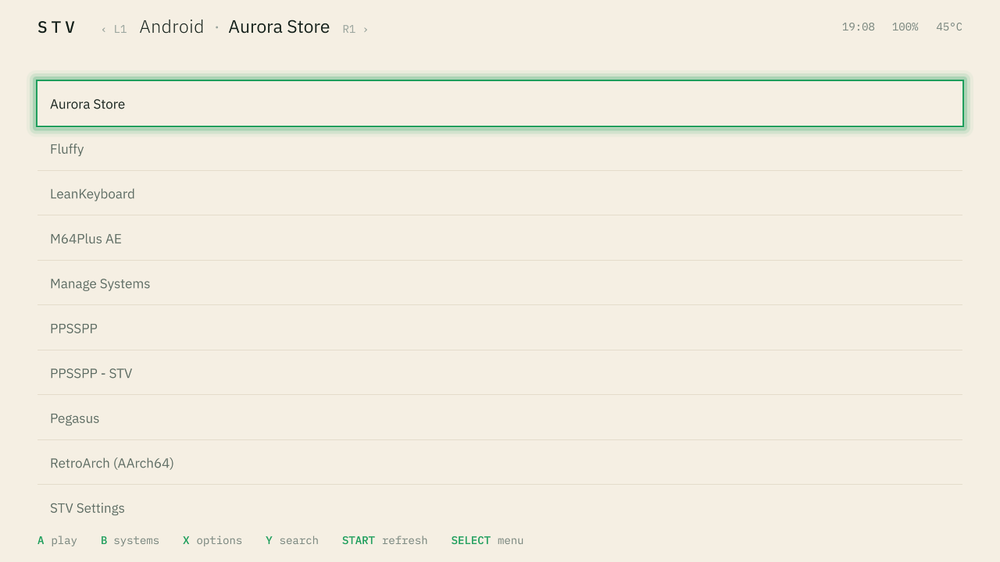

**Themes:** *STV Claro* and *STV Oscuro* follow the light or dark theme chosen in STV Settings. *STV Neo* is a
version of the Retro Mega Neo theme by hazem-abdelghani, adapted for this console (CC BY-NC-SA 4.0). Change it
in **SELECT › Settings › Theme**.

## Control center (HOME)

The control center is the console's quick-settings panel. **HOME** opens it over whatever is on screen, so
you can change the brightness, the Wi-Fi, the fan or the performance profile without leaving the game. It
also takes screenshots and opens the notices.

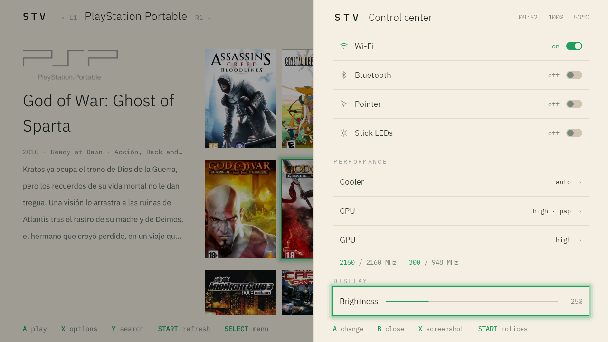

| Row | What it does |
|---|---|
| **Wi-Fi**, **Bluetooth** | Turn the radio on or off |
| **Pointer** | Mouse mode: the right stick moves a cursor and the left one scrolls (for apps made for touch) |
| **Stick LEDs** | Turns the rings around the sticks on or off |
| **Cooler** | Fan: *auto* (default), *low*, *medium*, *max* or *off* |
| **CPU** | Performance profile: *powersave*, *normal*, *high*, *high · psp* (default) or *max* |
| **GPU** | Graphics profile, same options |
| **Brightness** | Left and right adjust it |

The default CPU profile, *high · psp*, is optimized for PSP. The *max* profile raises the limits further, with
more heat and battery use. Below the profiles, the panel shows the current CPU and GPU clocks.

**A** changes the selected row, **B** closes the panel, **X** takes a screenshot (saved in
`Pictures/Screenshots`) and **START** opens the [notices](#notices).

**Y** on the CPU or GPU row opens the **performance monitor**: the clock of each core over the last
15 minutes, next to the cap of the current profile. Left and right expand one core.

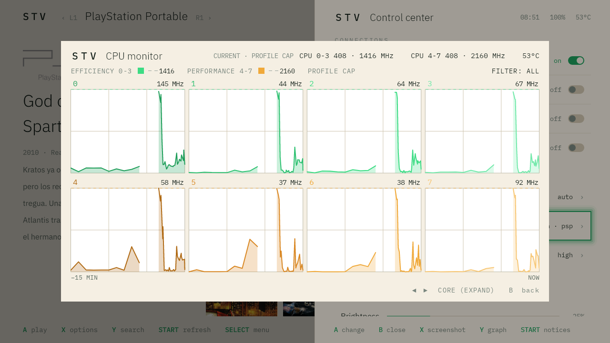

## Open apps (MENU)

The open apps view is the console's app switcher. **MENU** shows the open apps and what each one is doing
(playing, in use, in the background), to return to a game without reopening it, or to close what is not in
use and free memory. The free memory is shown at the top.

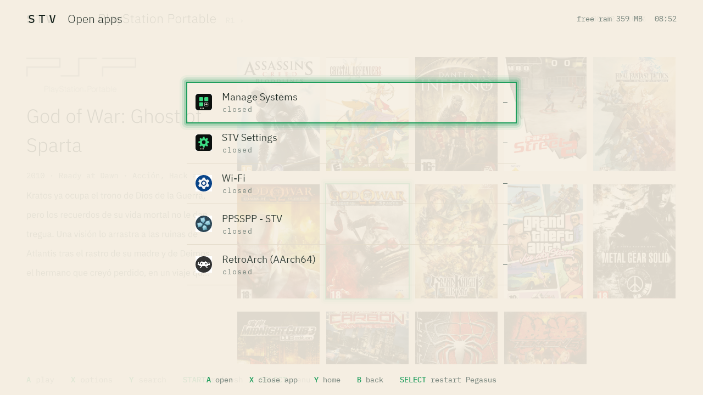

**A** opens the selected app, **X** closes it, **Y** goes to the home screen, **B** goes back and **SELECT**
restarts Pegasus.

## Notices

The console has no status bar: notices are where it reports a low battery, a high temperature, a connected
USB cable or a saved screenshot, and where app notifications go.
**START** in the control center opens them: **A** opens one, **X** dismisses it and **Y** clears them all.
With *Vibration on alerts* on, the console vibrates once for each new notice.

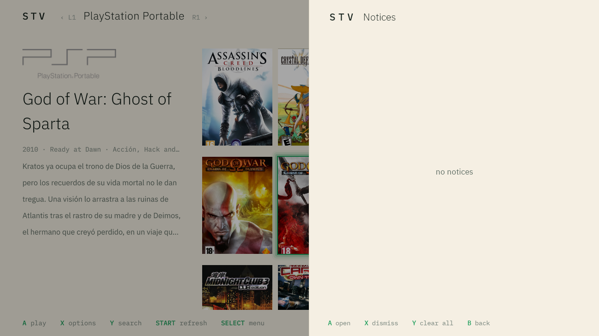

## Lock screen

The lock screen prevents accidental presses when the console wakes up. It shows the clock, the date and the
battery; press **L1 + R1** together to unlock it.

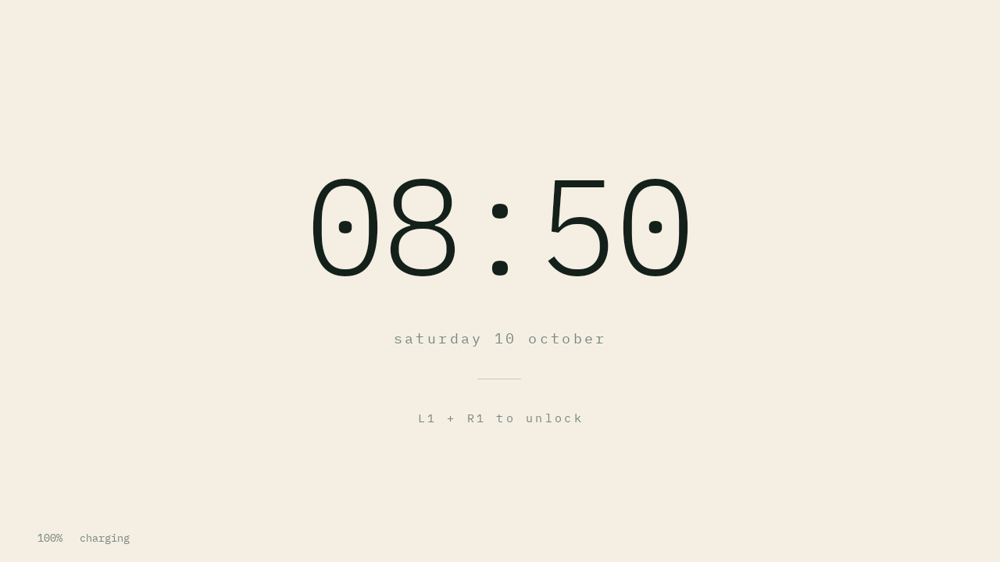

Choose the lock in **STV Settings › Security**: *None*, *L1 + R1* (default) or a *PIN* of 4 to 16 digits.
The PIN is typed with the gamepad: the D-pad moves the selection, **A** types, **B** deletes and **START**
confirms.

## STV Settings

STV Settings is the console's settings app. It replaces Android's settings, made for touch screens, with a
list of what matters on this console: display, sound, LEDs, lock, storage, updates. The full Android settings
remain available under *System*. **A** chooses, **B** goes back, left and right adjust.

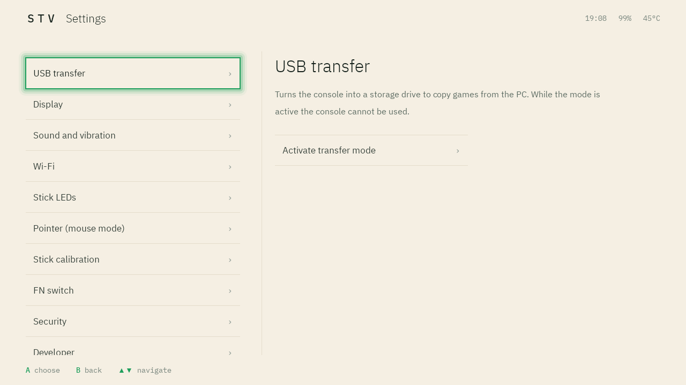

| Section | What is there |
|---|---|
| **USB transfer** | A computer sees the console as a drive, to copy games. The console cannot be used while it is active |
| **Display** | Brightness, screen timeout, color temperature, text size and theme (light or dark; it changes Android, the STV apps and Pegasus together) |
| **Sound and vibration** | Vibration on button press and on notices, headphone gain and the microphone for games |
| **Wi-Fi** | Android's Wi-Fi screen |
| **Stick LEDs** | Color and brightness of each ring, with a custom RGB color |
| **Pointer (mouse mode)** | On or off, and the cursor speed |
| **Stick calibration** | Measures the center and travel of both sticks and applies the result in every app and emulator; a dead zone for each stick and a way back to the automatic calibration |
| **FN switch** | What the FN switch does when set to ON |
| **Security** | The [lock screen](#lock-screen) |
| **Developer** | USB debugging (adb) and root access. Off on a clean install |
| **Storage** | Space used on the internal memory and on the microSD card; in the microSD installation, also *Expand to the whole card* |
| **System** | Restart, power off, and the full Android settings (Bluetooth pairing, keyboard, app permissions) |
| **System language** | Android's language list. STV OS is in English and Spanish; the STV apps and Pegasus follow it |
| **Date and time** | Time zone: *Coordinated Universal Time (UTC)* or a region and a city. The time sets itself over Wi-Fi |
| **System update** | Install a new version, or go back to the previous one ([updates](#updates)) |
| **Support the project** | A QR code to the support page |
| **About this console** | Version, kernel, memory, storage, installation type and third-party licenses |

<table>
<tr><td>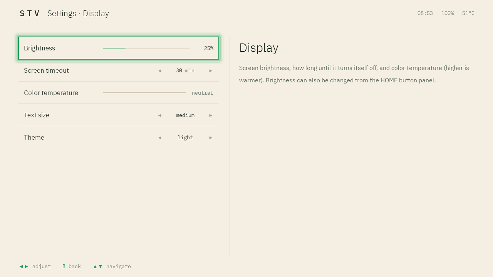</td><td>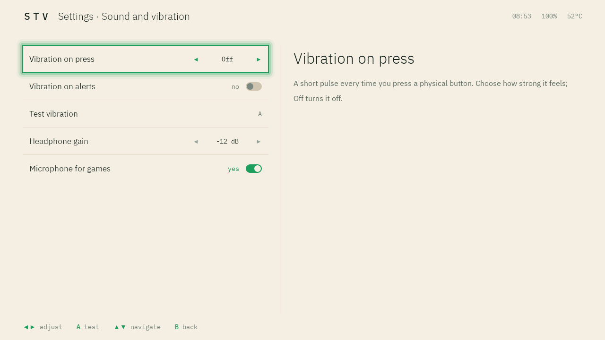</td></tr>
<tr><td>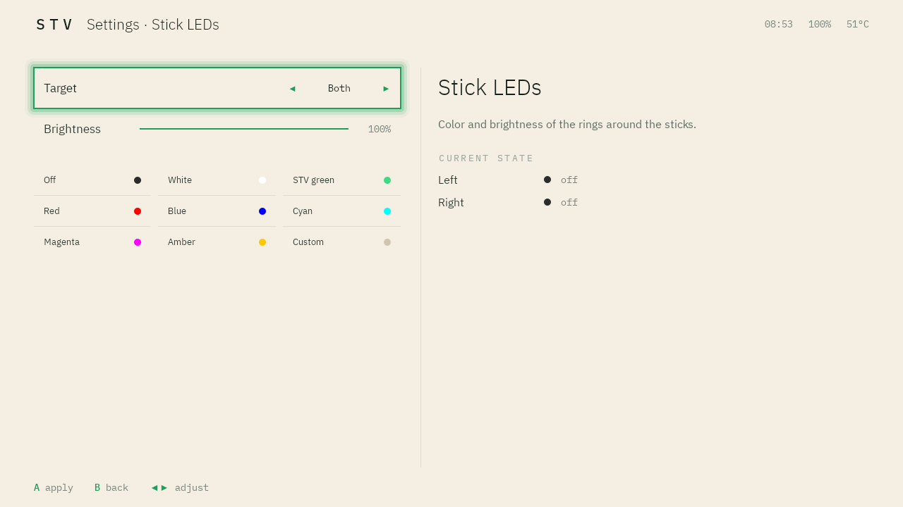</td><td>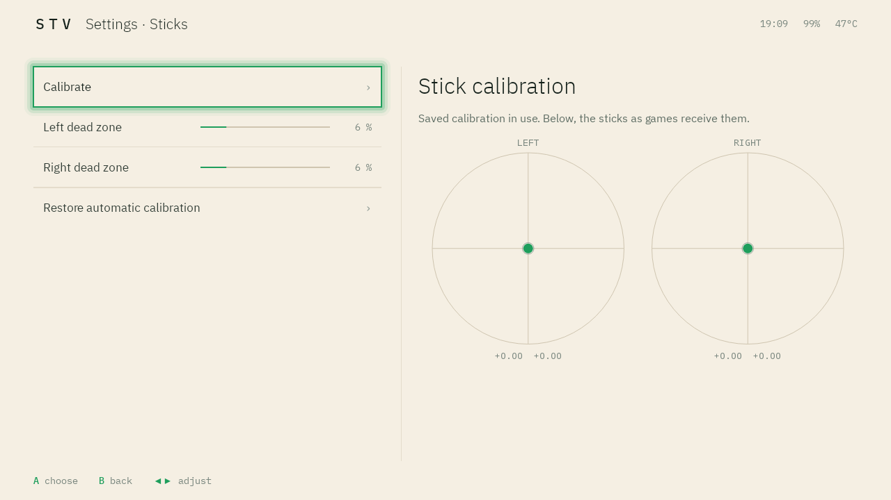</td></tr>
<tr><td>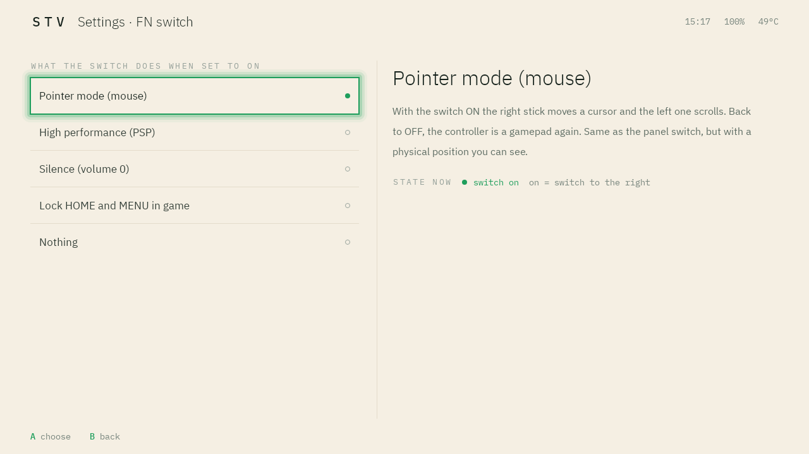</td><td>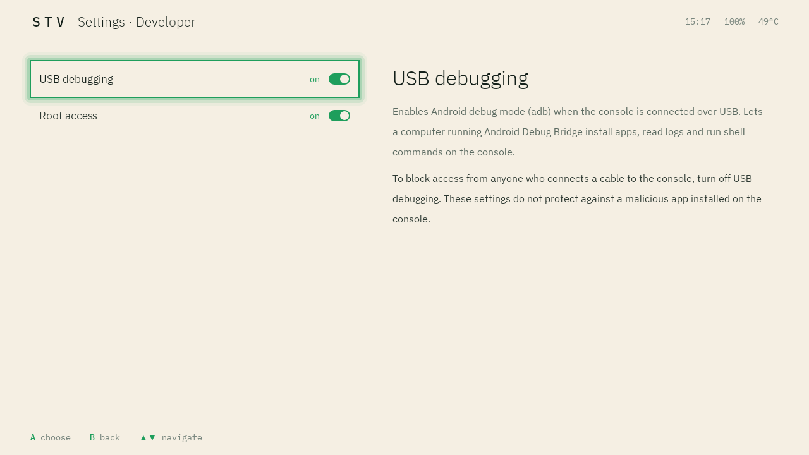</td></tr>
<tr><td>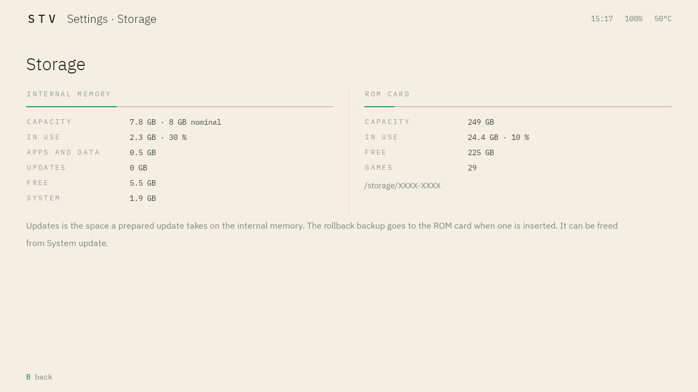</td><td>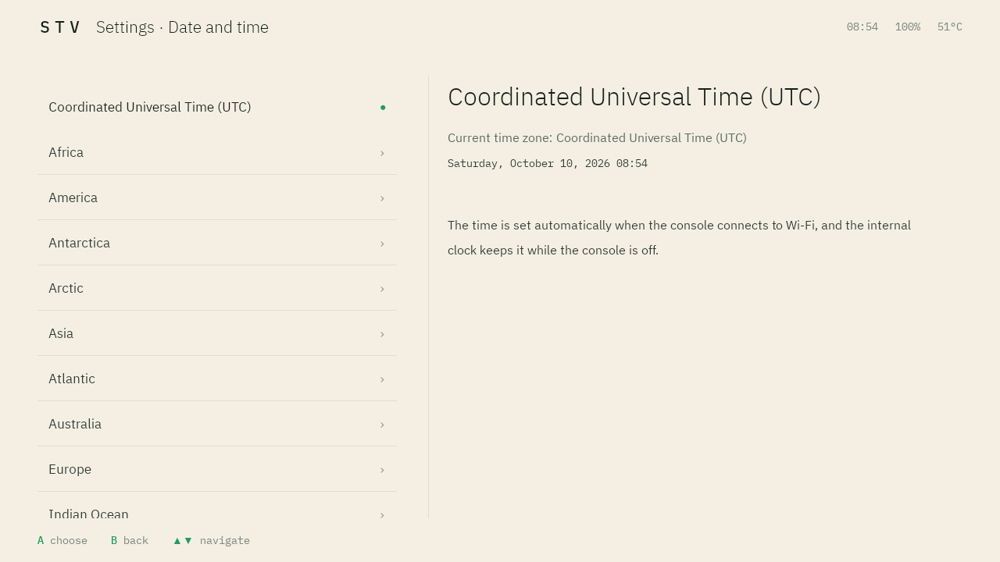</td></tr>
<tr><td colspan="2">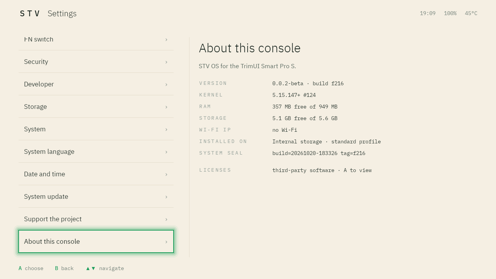</td></tr>
</table>

## Manage Systems

*Manage Systems* manages the game library. A *system* is an emulated console (PSP, Nintendo 64, Game Boy…):
the app adds systems, installs their emulator cores, finds box art and backs up saves. It is in the **Android** system of the home screen.

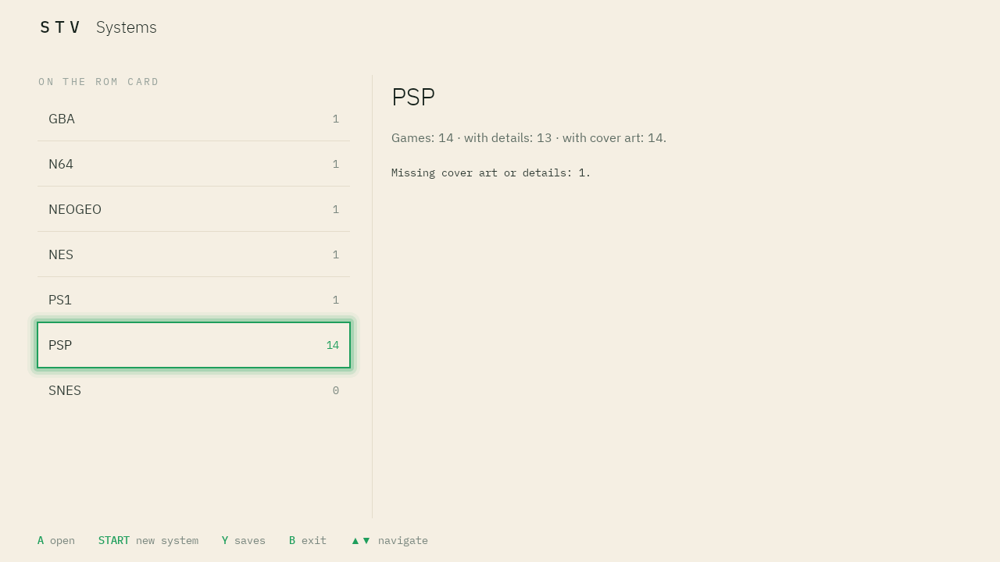

- **A on a system** lists its games, with a dot on those that already have box art and details.
  *Get what is missing* looks them up online (it needs Wi-Fi and takes a few seconds per game);
  *Get everything again* repeats it for all.
- **Y inside a system** shows its emulator core: which one is in use, and *Update core* to download the
  latest one.
- **START** opens the catalog of systems. Choosing one creates its `Roms/<system>` folder, sets up its
  emulator and, if needed, downloads the core.
- **Y on the list** opens [saves](#saves): *Back up* and *Restore*.

<table>
<tr><td>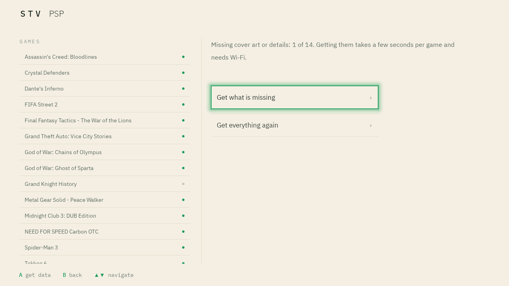</td><td>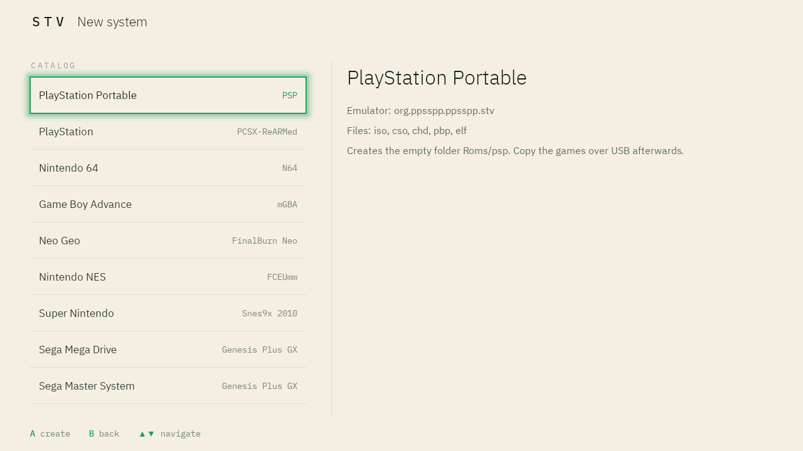</td></tr>
<tr><td>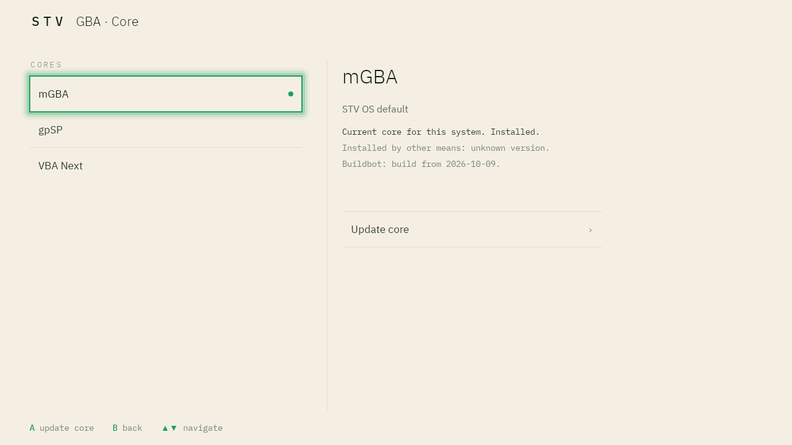</td><td>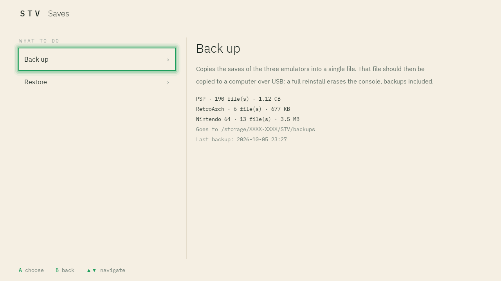</td></tr>
</table>

## Emulators

STV OS installs and configures the emulators. Each system opens with the one in this table:

| System | Emulator | Notes |
|---|---|---|
| PSP | **PPSSPP - STV** (default) and the official PPSSPP | [Optimized for this console](#ppsspp---stv) |
| Nintendo 64 | Mupen64Plus FZ | GLideN64, the fastest renderer on this console |
| PlayStation | RetroArch (PCSX-ReARMed) | Works without a BIOS file for most games |
| Game Boy Advance | RetroArch (mGBA) | |
| Game Boy, Game Boy Color, NES, SNES | RetroArch (Gambatte, FCEUmm, Snes9x 2010) | |
| Neo Geo, arcade, CPS-1, CPS-2, CPS-3 | RetroArch (FinalBurn Neo) | **Not included** (its license allows only non-commercial use). The first time you open one of these games, *Manage Systems* offers *Install core* (needs Wi-Fi, about 70 MB) |
| MAME | RetroArch (MAME 2003-Plus) | **Not included** (its license allows only non-commercial use). Uses MAME 0.78 romsets; MAME 2010 and MAME 2000 are available as alternatives for other romsets. Installed the same way as FinalBurn Neo (needs Wi-Fi, about 40 MB) |
| Others | RetroArch | Added from the catalog in *Manage Systems* |

## PPSSPP - STV

PPSSPP - STV is a version of PPSSPP 1.20.4 adapted to this console's hardware: the Allwinner A523, its
Mali-G57 GPU, 1 GB of RAM and the 1280×720 screen. It is the default PSP emulator; the official PPSSPP is
installed next to it. Every change was measured on the console, scene by scene, and keeps the image identical
to the original ([results](overview.md#psp-performance)).

What you see:

- **Resolutions for this screen**, in *Graphics › Rendering resolution*: *2.25x PSP (STV)* (1080×612) and
  *Panel 1:1 (STV)*, the exact size of the screen, plus intermediate steps (1.25x, 1.5x, 1.75x, 2.5x, 2.75x).
- **Frame rate cap (STV)**: holds a game at 30 fps, for titles designed for 30, with steady frame pacing.
- **Settings per game**: the settings changed while playing are saved for that game, not for all.
- **Buttons in the PSP layout**, the same for every game, and the pause menu on **L2**.

How it gets there:

- **Graphics on their own thread.** The emulated CPU no longer waits for the graphics commands: +10% of
  speed and 61% fewer audio cuts in the heaviest scenes.
- **Rendering adjusted to the Mali-G57**, a tile-based GPU: screen clears drawn as geometry, render area
  aligned to the tile size and fewer memory passes per frame.
- **Cheaper shadows.** The shadow volumes of the *God of War* games and *Dante's Inferno* are split into short
  segments and each projection is clipped to the part of the screen it can change.
- **No wasted work.** Draws that change nothing are skipped, texture copies are limited to what was written
  and format reinterpretations to what changed since the last one; auxiliary buffers such as shadow maps can
  render at a lower scale per game.
- **No memory allocations in the hot path.** The console's memory allocator runs in low-RAM mode and is
  slow under load; the graphics thread avoids it.
- **PSP Color** (the original screen's color response) applied in the final pass, in 16-bit floating point.

## Games and the Roms folder

Games go in a `Roms` folder, with one lowercase subfolder per system: `Roms/psp`, `Roms/n64`, `Roms/gba`,
`Roms/ps1`, `Roms/neogeo`, `Roms/nes`, `Roms/snes`…

- **Internal memory installation:** `Roms` is at the root of the microSD card (FAT32). Copy the games with a
  card reader or over USB (*USB transfer* shows the card as a second drive). You can insert and remove the
  card with the console on; the library updates by itself.
- **microSD installation:** `Roms` is in the console's internal storage, the drive a computer sees with
  **STV Settings › USB transfer**. Copy the games that way.

Games go directly in the system folder, not in subfolders, and their file names cannot have more than three
dots, counting the extension. *Manage Systems* creates the folders and the `metadata.pegasus.txt` file of each
system. After copying games, press **START** on the home screen to refresh the library.

## Saves

Each emulator keeps its saves in its own folder. *Manage Systems* backs them all up in one file.

| Emulator | Internal memory installation | microSD installation |
|---|---|---|
| PSP | On the card: `Android/data/org.ppsspp.ppsspp.stv/files/PSP/` | Internal storage, same path |
| RetroArch | On the card: `Android/data/com.retroarch.aarch64/files/` | Internal storage: `RetroArch/saves` and `RetroArch/states` |
| Nintendo 64 | On the card: `STV/saves/n64/` | Internal storage: `M64Plus/GameData/` |

**Back up:** *Manage Systems* › **Y** › *Back up* puts the saves of these three emulators in one file,
`STV/backups/saves-<date>.zip` (on the card in the internal memory installation). Copy it to a computer:
reinstalling erases the internal storage. **Restore** lists the backups and can keep a copy of the current
saves first.

In the internal memory installation, the saves live on the card: without it, the emulators cannot save, and
the console warns about it. Do not remove the card while a game is open.

## Updates

STV OS updates from the console, without reinstalling. Each version publishes one update package per
installation type, signed, that installs over any earlier version and keeps games, saves, apps and settings.
The previous version stays available to go back to.

1. Download the package for your installation from [Available versions](releases.md#available-versions): the
   one ending in `-internal-memory.zip` or the one ending in `-microsd.zip`. Do not rename or unzip it.
2. Copy it to the `STV/update` folder of the internal storage. The `Download` folder also works and, in the
   internal memory installation, so does `STV/update` on the card.
3. Open **STV Settings › System update**. It finds the package, shows its notes and asks to confirm.
4. The console prepares the update in a few minutes while you keep using it, then restarts and installs it.
   The logo stays on screen for about 3 minutes. Do not turn it off.
5. The console restarts with the new version. **Go back to <build>** returns to the previous one.

The update needs 40% battery or the charger connected. A package made for the other installation type is
rejected before anything is written, and only signed packages are accepted.

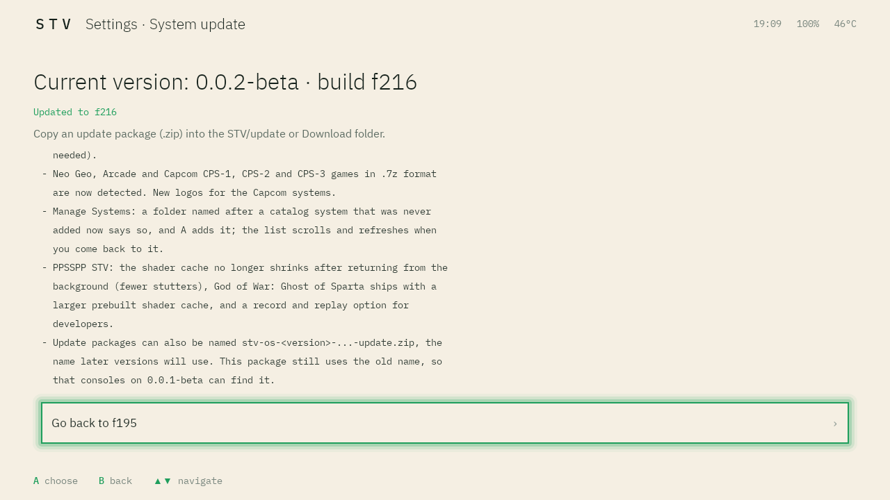

## Troubleshooting

**Console does not start?**

- **microSD installation:** remove the card. If the console starts its factory firmware, the problem is the
  card: write it again with Raspberry Pi Imager (this erases it).
- **Internal memory installation:** install STV OS again by following
  [Install on the internal memory](releases.md#install-on-the-internal-memory). The internal data is erased;
  games and saves on the card stay.

**Screen stays black after a restart?** Press POWER once to turn the screen off and again to turn it on.

**Both stick rings turned red?** The internal storage switched to read-only after a file system error (for
example, a power cut). Nothing is being saved. Turn the console off from **STV Settings › System › Power
off** and on again. It checks and repairs the storage while starting.

**Does a stick move on its own or not reach full range?** Open **STV Settings › Stick calibration** and
choose *Calibrate*: release both sticks and, when asked, rotate them slowly along the edge. If movement still
shows up without touching the stick, increase its *dead zone*.

**Forgot the PIN?** It cannot be recovered. Installing STV OS again removes it, along with the console's
internal data; in the internal memory installation, games and saves on the card stay.

**Game not showing up?** Check that it is directly in `Roms/<system>/`, that the system folder has its
`metadata.pegasus.txt` (created by *Manage Systems*) with the game's extension listed, and that the name has
no more than three dots. Then press **START** on the home screen.

**Neo Geo, arcade or MAME game opens the core screen?** FinalBurn Neo and MAME 2003-Plus are not included. Press **A** on
*Install core* (needs Wi-Fi), then **B** to go back; the game opens.

## Reporting a problem

Include:

- the version and build shown in **STV Settings › About this console** (for example,
  *0.0.2-beta · build f216*);
- the installation type (internal memory or microSD);
- what you did, what you expected and what happened, with a screenshot if possible (**HOME**, then **X**).

Report it in this repository's [Issues](https://github.com/stv-os-android/stv-android-releases/issues).
